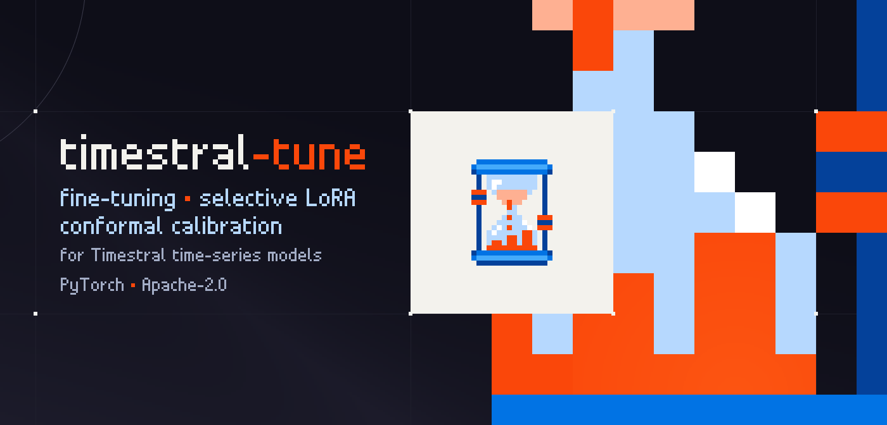

<p align="center">
  
</p>

# timestral-tune

[](https://pypi.org/project/timestral-tune/)
[](https://pypi.org/project/timestral-tune/)
[](https://github.com/eyenoticeall/timestral-tune/actions/workflows/ci.yml)
[](https://github.com/eyenoticeall/timestral-tune/blob/main/LICENSE)

Adapt Mistral AI's [Timestral](https://arxiv.org/abs/2610.37585) time-series foundation models to your own
data: fine-tune them, attach small LoRA adapters, or just recalibrate their prediction intervals.

The [official package](https://github.com/mistralai/timestral) runs the released models but cannot train
them. `timestral-tune` adds the training side, for all four released sizes (5M, 28M, 123M and 209M
parameters), in plain PyTorch on CUDA, CPU and Apple GPUs.

- **Faithful to the paper and the official code.** The training forward pass, attention masks,
  normalisation and loss are tested against the official inference path on the released weights; in
  float64 the two agree to 1e-12.
- **No leakage, and you can check it.** Windows are point-in-time, covariates keep their roles
  (past-only or known in advance), and one call runs the leakage and parity checks on your own batch.
- **Results you can take elsewhere.** A fine-tuned checkpoint loads in the official package unchanged.
- **Forgetting is measured, not assumed.** The benchmarks report how much each tuned model lost on data
  it was not tuned on.

It is an alpha release: well tested, but the API may still change between 0.x versions
([changelog](https://github.com/eyenoticeall/timestral-tune/blob/main/CHANGELOG.md)).

## Install

```bash
pip install timestral-tune        # or: uv add timestral-tune
```

Requires Python 3.10+ and PyTorch 2.4+ (2.8+ for the Apple GPU). The data layer reads polars, pandas and
pyarrow frames, so install whichever you use; none is a dependency. Model weights are downloaded from the
Hugging Face Hub on first use, under Mistral AI's licence (see [below](#licence-and-important-restrictions)).

## Quick start

Fine-tune the 5M model on an hourly load series with one past-only and one known-in-advance covariate:

```python
from timestral_tune import LoraConfig, TimestralTrainer, TrainingConfig
from timestral_tune.data import TimeSeriesDataset

# A long-format frame: one row per (series, timestamp). polars, pandas and pyarrow all work.
dataset = TimeSeriesDataset.from_polars(
    df,
    id_col="symbol",
    time_col="timestamp",
    target_cols=["load"],
    past_covariates=["temperature"],     # known up to the forecast origin only
    known_covariates=["is_holiday"],     # known in advance over the horizon
    context_length=512,
    forecast_horizon=96,
    stride=96,
)
train, validation = dataset.split_by_time("2024-02-15")   # training sees nothing from this date on

config = TrainingConfig(
    model_name_or_path="mistralai/Timestral-5M",
    mode="lora_variate",
    batch_size=8,
    epochs=3,
    output_dir="./runs/load-lora",
)
lora = LoraConfig(r=8, lora_alpha=16, axes=("variate",), targets=("q", "v"))
trainer = TimestralTrainer(config, train, validation, lora_config=lora)
print(trainer.evaluate().loss)   # zero-shot validation loss
result = trainer.fit()           # trains only the variate LoRA adapters
print(result.best_eval_loss)
trainer.export()                 # writes upstream-loadable merged checkpoint + adapters + NOTICE/LICENSE
```

Then score and forecast with the result:

```python
from timestral_tune.models import load_forecaster
from timestral_tune.utils import evaluate_forecaster

forecaster = load_forecaster("./runs/load-lora")          # device="cpu" by default; "cuda" and "mps" also work
metrics = evaluate_forecaster(forecaster, validation, seasonality=24)
print(metrics.wql, metrics.mase)                           # raw-unit scores on the held-out windows

forecast = forecaster.forecast(      # arrays or tensors of recent history
    context,                    # (series, targets, time)
    prediction_length=96,
    past_covariates=past,       # (series, covariates, time)
    known_covariates=known,     # (series, covariates, time + 96)
)
forecast.median                 # (series, targets, 96)
forecast.quantiles              # (series, targets, 96, 21)
```

## Choosing how much to change

The options form a ladder. Start at the top and go down only if the step above is not enough.

| Option | What changes | Trainable parameters (28M) | Reach for it when |
|---|---|---:|---|
| Conformal calibration | Nothing in the model; interval offsets are fitted | 0 | You have little data, or only need honest intervals |
| `head_only` | The quantile head | 1.9M | The shape of the distribution differs, such as heavier tails |
| `lora_variate` | Low-rank adapters on attention across a series' targets and covariates | 74k | Relationships between targets and covariates differ |
| `lora_temporal` | Low-rank adapters on attention over time | 295k | Seasonality or regimes differ |
| `full_ft` | All weights | 27.8M | You have a large dataset (1,000+ series) |

The four training modes are `TrainingConfig(mode=...)`; conformal calibration is a separate step that
needs no training (see below). LoRA counts are for the default adapter settings.

Default learning rates (`head_only` and `lora_variate` 3e-3, `lora_temporal` 1e-3, `full_ft` 1e-4) and
the default adapter (`r=8`, all four attention projections) come from sweeps across all four model sizes.
For `full_ft` on 5M and 28M, `learning_rate=3e-4` gave lower error in our benchmarks, at the cost of two
to three percentage points more forgetting; keep 1e-4 on 123M and 209M.

## Results

Weighted quantile loss on held-out data (lower is better) for Timestral-28M at the default settings,
mean and standard deviation over three seeds:

| | Retail demand | Realised volatility |
|---|---:|---:|
| Best classical baseline | 0.2177 | 0.2253 |
| Zero-shot | 0.2193 | 0.2293 |
| `lora_variate` | 0.1979 ± 0.0010 | 0.2185 ± 0.0020 |
| `lora_temporal` | 0.1977 ± 0.0001 | 0.2171 ± 0.0016 |
| `full_ft` | **0.1951 ± 0.0004** | **0.2161 ± 0.0012** |

- **Fine-tuning helped at every size.** Across the four model sizes and both datasets, the LoRA modes and
  `full_ft` lowered the loss by 3% to 14% against zero-shot.
- **Forgetting stayed small for LoRA and `full_ft`.** On three unrelated public datasets their loss
  moved by between -2.7% and +4.6%. `head_only` at its default rate forgot more, +5% to +14% on the two
  sizes measured.
- **Zero-shot did not beat the classical baselines here; tuned models did.** The baselines are a
  seasonal ridge regression (retail) and a HAR model (volatility).
- **Read these with their limits.** The volatility test set is the 18 days of data after the models'
  release, only three time blocks, so its evidence over time is thin. The retail data is from 2024 and
  may have been in the models' training mix; there the gain holds on 63 or 64 of 64 series and on all
  six time blocks.

Every table, the raw results and the commands to reproduce them are in
[docs/BENCHMARKS.md](https://github.com/eyenoticeall/timestral-tune/blob/main/docs/BENCHMARKS.md).

## Calibrate intervals without training

Conformal calibration leaves the model untouched. It measures the forecast errors on a held-out
calibration period and shifts the quantiles so that interval coverage moves towards the level you ask
for:

```python
from timestral_tune import ConformalCalibrator, collect_conformal_data
from timestral_tune.models import load_forecaster

zero_shot = load_forecaster("mistralai/Timestral-5M")                 # the released weights, untouched
calibration, test = validation.split_by_time("2024-02-28")

preds, actuals, scale = collect_conformal_data(zero_shot, calibration)
calibrator = ConformalCalibrator(target_coverage=0.80).fit(preds, actuals, scale)

test_preds, test_actuals, test_scale = collect_conformal_data(zero_shot, test)
calibrated = calibrator.transform(test_preds, context_scale=test_scale)   # (windows, 96, 21) quantiles
```

A calibration fitted on one period lags when the data changes regime. `OnlineConformalCalibrator` keeps
adjusting as observations arrive; in our volatility benchmark it still under-covered right after a regime
jump and then over-corrected. Pass either one to `trainer.export(calibrator=...)` to ship it with a
checkpoint.

## Limit forgetting

Pass a `ReplayConfig` to keep a tuned model close to the original on data it is not being tuned on. Its
default adds a light distillation term that pulls forecasts on built-in synthetic series towards the
frozen base model; it needs no extra data and no labels:

```python
from timestral_tune import ReplayConfig

trainer = TimestralTrainer(config, train, validation, lora_config=lora, replay_config=ReplayConfig())
```

In our measurements it helped most for `head_only`; for `full_ft`, lowering the learning rate did as
well. You can also supply your own general-purpose dataset as `replay_dataset`. Details and numbers are in
[docs/BENCHMARKS.md](https://github.com/eyenoticeall/timestral-tune/blob/main/docs/BENCHMARKS.md) §5.

## Check your own data

Run the leakage and parity checks on a batch of your data before trusting a training run:

```python
from timestral_tune.utils import run_checks

batch = dataset.collator(trainer.model.config)([dataset[i] for i in range(8)]).to(trainer.device)
for check in run_checks(trainer.model, batch):
    print(check)
```

They confirm that the forward pass matches the official one, that labels cannot reach the predictions,
that covariates respect their roles, and that the loss scores only the positions it should.

## What an export contains

`trainer.export()` writes a directory that the official `timestral` package loads as it is:

```
config.json            the official schema, unchanged
model.safetensors      merged weights under the official parameter names
adapter.safetensors    LoRA modes only: the adapters on their own, for load_lora()
adapter_config.json    LoRA modes only
conformal.json         if a fitted calibrator was passed
tune_metadata.json     base model and revision, mode, settings, data fingerprint, library version
LICENSE, NOTICE        Mistral AI's weights licence and a notice that the weights are a derivative
```

On a Mac the official package runs on CPU only; `load_forecaster(..., device="mps")` runs the same
forecaster on the Apple GPU.

## Hardware and versions

| Device | Needs | Precision | Checked on |
|---|---|---|---|
| CPU | PyTorch 2.4+ | float32 | PyTorch 2.4, 2.8, 2.14, 2.15; Python 3.10 to 3.13 |
| NVIDIA GPU | PyTorch 2.4+ | float32 or `bf16` | One NVIDIA L4, PyTorch 2.15 |
| Apple GPU | PyTorch 2.8+ | float32 | One Apple M4 (16 GB), all four sizes |

On CUDA, `mixed_precision="bf16"` with `compile_model=True` ran 28M training steps about three times
faster than float32. Multi-GPU training is untested.

## Limits

- One training forward covers a forecast horizon of up to 1,024 steps and a context of up to 32,768.
- It adapts the released checkpoints; it does not reproduce Mistral AI's pre-training.
- Any public dataset may have been part of the models' training data, so benchmark gains are evidence,
  not proof.
- The official code is vendored at a pinned commit. A change upstream can require a new release here.

More in the [specification](https://github.com/eyenoticeall/timestral-tune/blob/main/docs/SPEC.md), §12.

## Documentation

| | |
|---|---|
| [Specification](https://github.com/eyenoticeall/timestral-tune/blob/main/docs/SPEC.md) | Design, maths, API and the decisions behind them |
| [Benchmarks](https://github.com/eyenoticeall/timestral-tune/blob/main/docs/BENCHMARKS.md) | All results, with raw data and reproduction commands |
| [Verification record](https://github.com/eyenoticeall/timestral-tune/blob/main/docs/VERIFICATION.md) | What was measured, on what hardware, and how to repeat it |
| [Status](https://github.com/eyenoticeall/timestral-tune/blob/main/docs/STATUS.md) | What works today and what is next |
| [Changelog](https://github.com/eyenoticeall/timestral-tune/blob/main/CHANGELOG.md) | Changes by release |

## Development

Requires Python 3.10+ and [uv](https://docs.astral.sh/uv/).

```bash
uv sync                          # create the environment
uv run pytest                    # downloads the 5M and 28M checkpoints on first run
uv run pytest -m "not network"   # no downloads; what CI runs
uv run ruff check . && uv run ruff format --check .
```

More in [docs/DEVELOPMENT.md](https://github.com/eyenoticeall/timestral-tune/blob/main/docs/DEVELOPMENT.md). Contributors and coding agents should read
[AGENTS.md](https://github.com/eyenoticeall/timestral-tune/blob/main/AGENTS.md) first.

## Licence and important restrictions

- **This software** is licensed under [Apache 2.0](https://github.com/eyenoticeall/timestral-tune/blob/main/LICENSE). It includes a vendored copy of Mistral AI's
  Apache-2.0 `timestral` package; see [NOTICE](https://github.com/eyenoticeall/timestral-tune/blob/main/NOTICE).
- **Timestral model weights are not covered by Apache 2.0.** They are downloaded from the Hugging Face Hub
  under Mistral AI's Modified MIT License. That licence grants no rights to anyone whose company (or
  employer) had global consolidated revenue above **$20 million** in the preceding month, and it applies to
  derivatives and modifications. **Weights fine-tuned with this toolkit are derivatives** and carry the same
  restriction. Read the licence in the model repositories before using the weights. This is a summary, not
  legal advice.
- **Independence.** This is an independent community project, not affiliated with or endorsed by
  Mistral AI. "Timestral", the base architecture and the weights are Mistral AI's.
