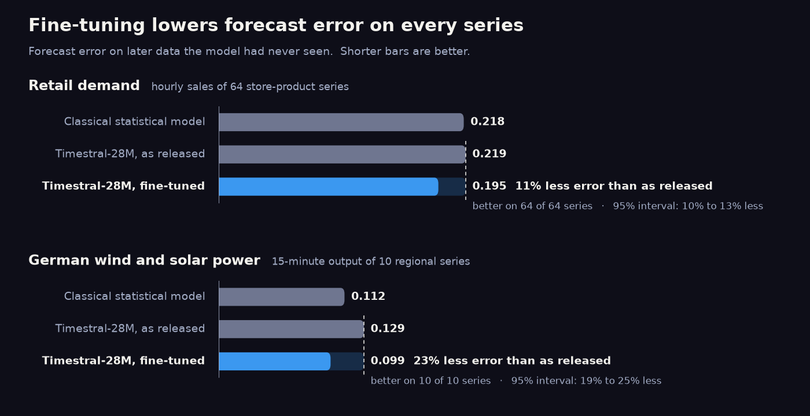

# Phase 3 Benchmarks & Hyperparameter Sweeps

## Summary

Fine-tuning cut forecast error by about 11% on retail demand and 6% on stock volatility, in under a
minute on a single GPU.



We fine-tuned Timestral-28M on two real datasets and scored it on later data it had never seen. The
bars show how far the forecasts were from what happened, so shorter is better. The dashed line marks
the model exactly as Mistral AI released it.

These gains are not noise:

- **Nearly every series improved.** Fine-tuning made the forecasts better on all 64 retail series and
  on 50 of the 51 stocks.
- **It held up over time.** Splitting the test data into consecutive periods, the fine-tuned model was
  ahead in 6 of 6 periods on retail demand and in 46 of 49 on stock volatility.
- **The uncertainty is small next to the gain.** The 95% confidence interval is 10% to 13% less error
  on retail demand and 5% to 7% less on stock volatility.
- **Repeating the training changes little.** Three fine-tuning runs on retail demand with different
  random seeds landed within 0.4% of each other.

What else we found:

- **Every model size improved**, from 5M to 209M.
- **A small fine-tuned model can beat a larger one as released.** On retail demand the fine-tuned 5M
  model made 7% to 10% less error than every model size as released, the 209M included.
- **Little was forgotten.** On three unrelated datasets, the error of the fully fine-tuned models moved
  by less than 3% either way.
- **Against a tuned gradient-boosted model the result is mixed.** Gradient boosting is a stronger
  baseline than the classical models in the chart. Fine-tuned Timestral-28M made 8% less error than it
  on retail demand and 6% less on stock volatility, the two datasets in the chart, whose test periods
  mostly predate the models' release. On four test sets taken entirely from after the release (18 days
  of stock volatility, German wind and solar power, air pollution in Indian cities and wave heights off
  Sri Lanka) the two were level: no difference was larger than its margin of error. The fine-tuned 5M
  model did not beat gradient boosting on any of the four, and was clearly behind on German power.

The fine print:

- The chart uses full fine-tuning at default settings. Error is the weighted quantile loss, which
  scores the whole predicted range and not just a single best guess. The classical models are a
  seasonal ridge regression for retail demand and a HAR model for stock volatility.
- The gradient-boosted model is scikit-learn's `HistGradientBoostingRegressor`. It predicts the same
  range of outcomes, trains on a CPU, and has its settings chosen on validation data.
- The stock volatility test covers January to November 2026. Most of that is before the models'
  release in late October, so the released model may have seen some of it in its own training. On the
  18 days after the release the gain is the same 6%, but that is too short a period to confirm on its
  own (95% interval: 1.5% to 10%).
- The retail data is from 2024 and may also have been part of the models' training data.

The sections below hold the numbers behind this summary, with the commands to reproduce them: §1 and §3
for the four model sizes, §4 for the chart, its confidence intervals and the repeated runs, and §6.1 and
§6.3 for the comparison with gradient boosting.

## Measurement setup

All numbers below were measured on an NVIDIA L4 GPU (`g2-standard-4`, PyTorch 2.15.0+cu132,
Python 3.12, `bf16` autocast) on `2026-11-22`, evaluating every mode in raw space through the
vendored upstream `TimestralForecaster.forecast()` with its defaults (`symmetric_averaging=True`,
`clip_nonnegative=True`; spec §5.5). Raw JSON outputs for every table are committed in
`docs/benchmarks/`.

## Datasets, licences & contamination notes

| Role | Dataset (pinned HF Hub revision) | Licence | Shape & covariates | Scored test dates & contamination note |
|---|---|---|---|---|
| **Realised volatility** | `twelvedata/financial-world-model@da186e5fd362` (`bars_1h`, `target=rv_20`) | MIT | 51 large-cap US equities, 1h bars, 8 rows/series (`rv_20` + 5 past: `log1p(volume)`, `vix_level`, `spy_logret_1`, `sector_logret_1`, `atr_14` + 2 known calendar: hour, weekday). `context=256`, `horizon=32`, train `6,324` / val `1,071` / test `153` windows. | **Scored targets span `2026-11-03` to `2026-11-20`** — strictly after Timestral's `2026-10-27` release (no pretraining contamination on test targets). Training/validation bars precede release. |
| **Signed returns** | `twelvedata/financial-world-model@da186e5fd362` (`bars_1h`, `target=logret_20`) | MIT | Same 51 equities, covariates, and splits as realised volatility, with signed 20-bar log returns (`val` min `-0.225`, mean `+0.0009`, max `+0.247`). Used in §2.1 to test `sign_flip` on a signed target. | Same chronological split (`val` precedes release; test targets span `2026-11-03` to `2026-11-20`). |
| **Retail demand** | `Dingdong-Inc/FreshRetailNet-50K@c374e85975c8` | CC BY 4.0 | Top-64 store-SKU hourly series ranked strictly on **training-period sales** (days 0–69; zero val/test leakage), 9 rows/series (hourly sales + 3 past: stockout, precipitation, temperature + 5 known: discount, holiday, activity, hour, weekday). `context=256`, `horizon=48`, train `1,856` / val `384` / test `384` windows. | **Scored targets span `2024-06-21` to `2024-07-02`** — published prior to October 2026; **may have been seen** during Mistral's post-training (§12). |
| **Forgetting set** | `Salesforce/GiftEval@30841734ac5c` | Apache-2.0 | Evaluated per domain and **macro-averaged equally** across `ett1/H` (28 windows, energy), `jena_weather/H` (84 windows, weather), and `LOOP_SEATTLE/H` (80 windows, traffic) so high-magnitude weather pressure channels cannot dominate pooled wQL. | Reported as equal-weighted 3-domain **relative forgetting %** (`mean_d((tuned - zs) / zs)`). Positive = degradation; negative = transfer gain. Univariate series only (note: `lora_variate` Q/K slices are inert on 1-row series, T10). |

All licences permit publishing derived benchmark metrics (spec §8).

---

## 1. Main benchmark: Timestral-5M & Timestral-28M (`docs/benchmarks/bench_5m_28m.json`)

Reproduce:

```bash
uv run python scripts/benchmarks/run_benchmarks.py \
  --device cuda --bf16 --sizes 5M 28M --max-steps 200 --batch-size 32 \
  --output docs/benchmarks/bench_5m_28m.json
```

Uses the shipped defaults (D19): `sign_flip=True`, `head_only` `3e-3` (with dual-orientation `+x`/`-x`
frozen-feature cache), `lora_variate` `3e-3`, `lora_temporal` `1e-3`, `full_ft` `1e-4`, LoRA
`r=8, alpha=16, targets=("q","k","v","o")`, and `restore_best=True`. Benchmark runs pass
`dropout=0.05` explicitly (`LoraConfig.dropout` defaults to `0.0` in `config.py`). Online ACI runs
strictly chronologically across all series with horizon-reveal delay (`t_end < t_origin`, D20).

**GIFT-Eval zero-shot wQL baselines by domain:**
- **5M:** `ett1 = 0.1723`, `jena_weather = 0.0484`, `loop_seattle = 0.0585`
- **28M:** `ett1 = 0.1694`, `jena_weather = 0.0485`, `loop_seattle = 0.0573`

### Timestral-5M — Realised Volatility (`2026-11-03` to `2026-11-20`, 153 windows)

| Mode | Trainable params | Pinball | wQL | MASE | Cov 80% | Width 80% | Cov 90% | Width 90% | Macro Forg wQL | Macro Forg MASE | Peak VRAM / Time |
|---|---:|---:|---:|---:|---:|---:|---:|---:|---:|---:|---|
| `zero_shot` | 0 | 0.000939 | 0.2360 | 1.9167 | 0.663 | 0.00603 | 0.796 | 0.00823 | +0.0% | +0.0% | — |
| `conformal_cqr` | 0 | 0.000933 | 0.2346 | 1.9167 | 0.689 | 0.00634 | 0.825 | 0.00884 | +0.0% | +0.0% | — |
| `conformal_aci` | 0 | 0.000948 | 0.2384 | 1.9167 | 0.783\* | 0.00780 | 0.868 | 0.01147 | +0.0% | +0.0% | — |
| `head_only` | 792,576 | 0.000873 | 0.2195 | 1.8292 | 0.761 | 0.00629 | 0.884 | 0.00934 | +14.0% | +7.5% | 0.08 GiB / 12.5 s |
| `lora_variate` | 24,576 | **0.000872** | **0.2192** | **1.7845** | 0.728 | 0.00624 | 0.844 | 0.00879 | -2.7% | -1.3% | 0.16 GiB / 12.9 s |
| `lora_temporal` | 98,304 | 0.000880 | 0.2213 | 1.8007 | 0.719 | 0.00628 | 0.837 | 0.00878 | -1.0% | +1.4% | 0.24 GiB / 17.7 s |
| `full_ft` | 5,208,960 | 0.000876 | 0.2202 | 1.8009 | 0.726 | 0.00622 | 0.846 | 0.00882 | -1.0% | -1.0% | 0.36 GiB / 15.2 s |

### Timestral-28M — Realised Volatility (`2026-11-03` to `2026-11-20`, 153 windows)

| Mode | Trainable params | Pinball | wQL | MASE | Cov 80% | Width 80% | Cov 90% | Width 90% | Macro Forg wQL | Macro Forg MASE | Peak VRAM / Time |
|---|---:|---:|---:|---:|---:|---:|---:|---:|---:|---:|---|
| `zero_shot` | 0 | 0.000912 | 0.2293 | 1.8785 | 0.702 | 0.00641 | 0.825 | 0.00878 | +0.0% | +0.0% | — |
| `conformal_cqr` | 0 | 0.000909 | 0.2286 | 1.8785 | 0.712 | 0.00653 | 0.834 | 0.00908 | +0.0% | +0.0% | — |
| `conformal_aci` | 0 | 0.000920 | 0.2313 | 1.8785 | 0.790\* | 0.00770 | 0.865 | 0.01137 | +0.0% | +0.0% | — |
| `head_only` | 1,880,064 | 0.000861 | 0.2165 | 1.7985 | 0.755 | 0.00635 | 0.873 | 0.00943 | +10.4% | +4.6% | 0.21 GiB / 13.5 s |
| `lora_variate` | 73,728 | 0.000861 | 0.2164 | 1.7686 | 0.732 | 0.00599 | 0.847 | 0.00858 | -1.4% | -1.3% | 0.58 GiB / 18.3 s |
| `lora_temporal` | 294,912 | 0.000870 | 0.2188 | 1.7826 | 0.733 | 0.00608 | 0.855 | 0.00866 | -2.0% | -1.2% | 0.78 GiB / 24.7 s |
| `full_ft` | 27,821,184 | **0.000860** | **0.2163** | **1.7669** | 0.729 | 0.00582 | 0.860 | 0.00858 | -0.7% | -1.5% | 1.21 GiB / 21.4 s |

\* **ACI per-block 80% coverage across the 3 volatility blocks:** `zero_shot` scored `[0.531, 0.624, 0.833]`
(5M) and `[0.564, 0.705, 0.836]` (28M). `conformal_aci` cannot anticipate block 1's regime jump (`0.542` /
`0.557`), then widens aggressively and **overshoots** in blocks 2 and 3 (`[0.542, 0.906, 0.901]` on 5M;
`[0.557, 0.925, 0.889]` on 28M), averaging near `0.79` across the 3 blocks.

### Timestral-5M — Retail Demand (`2024-06-21` to `2024-07-02`, 384 windows)

| Mode | Trainable params | Pinball | wQL | MASE | Cov 80% | Width 80% | Cov 90% | Width 90% | Macro Forg wQL | Macro Forg MASE | Peak VRAM / Time |
|---|---:|---:|---:|---:|---:|---:|---:|---:|---:|---:|---|
| `zero_shot` | 0 | 0.1311 | 0.2210 | 0.8459 | 0.823 | 1.282 | 0.923 | 1.789 | +0.0% | +0.0% | — |
| `conformal_cqr` | 0 | 0.1311 | 0.2210 | 0.8459 | 0.823 | 1.282 | 0.923 | 1.789 | +0.0% | +0.0% | — |
| `conformal_aci` | 0 | 0.1311 | 0.2210 | 0.8459 | 0.810 | 1.269 | 0.916 | 1.779 | +0.0% | +0.0% | — |
| `head_only` | 792,576 | 0.1244 | 0.2098 | 0.8291 | 0.821 | 1.168 | 0.918 | 1.554 | +5.0% | +0.5% | 0.10 GiB / 4.4 s |
| `lora_variate` | 24,576 | 0.1203 | 0.2027 | 0.7880 | 0.803 | 1.092 | 0.904 | 1.476 | +2.0% | -0.8% | 0.21 GiB / 11.2 s |
| `lora_temporal` | 98,304 | 0.1207 | 0.2035 | 0.7883 | 0.807 | 1.084 | 0.908 | 1.471 | +1.8% | +1.3% | 0.33 GiB / 15.7 s |
| `full_ft` | 5,208,960 | **0.1193** | **0.2011** | **0.7847** | 0.803 | 1.080 | 0.908 | 1.449 | +0.4% | -1.1% | 0.47 GiB / 13.5 s |

### Timestral-28M — Retail Demand (`2024-06-21` to `2024-07-02`, 384 windows)

| Mode | Trainable params | Pinball | wQL | MASE | Cov 80% | Width 80% | Cov 90% | Width 90% | Macro Forg wQL | Macro Forg MASE | Peak VRAM / Time |
|---|---:|---:|---:|---:|---:|---:|---:|---:|---:|---:|---|
| `zero_shot` | 0 | 0.1301 | 0.2193 | 0.8347 | 0.766 | 1.253 | 0.882 | 1.693 | +0.0% | +0.0% | — |
| `conformal_cqr` | 0 | 0.1301 | 0.2193 | 0.8347 | 0.768 | 1.254 | 0.883 | 1.697 | +0.0% | +0.0% | — |
| `conformal_aci` | 0 | 0.1301 | 0.2193 | 0.8347 | 0.795 | 1.272 | 0.896 | 1.715 | +0.0% | +0.0% | — |
| `head_only` | 1,880,064 | 0.1229 | 0.2072 | 0.8125 | 0.815 | 1.164 | 0.913 | 1.546 | +6.9% | +1.3% | 0.24 GiB / 5.4 s |
| `lora_variate` | 73,728 | 0.1179 | 0.1987 | 0.7726 | 0.785 | 1.045 | 0.898 | 1.400 | -1.6% | -0.2% | 0.75 GiB / 15.6 s |
| `lora_temporal` | 294,912 | 0.1172 | 0.1976 | 0.7678 | 0.780 | 1.036 | 0.899 | 1.401 | +0.8% | +1.8% | 1.01 GiB / 21.7 s |
| `full_ft` | 27,821,184 | **0.1155** | **0.1946** | **0.7596** | 0.781 | 1.006 | 0.894 | 1.333 | -1.2% | -1.0% | 1.50 GiB / 18.9 s |

### Key findings across all four sizes (`5M`, `28M`, `123M`, `209M`)

- **Every gradient mode improves over zero-shot** across all four checkpoints and both datasets:
  wQL drops by **3.0%–14.0%** (lowest: `123M` volatility `full_ft` at 3.0%; highest: `209M` retail
  `full_ft` at 14.0%) and MASE drops by **1.6%–11.4%** (lowest: `209M` volatility `full_ft` at 1.6%;
  highest: `209M` retail `full_ft` at 11.4%).
- **Mode winners across the 8 `(size × dataset)` cells:** `full_ft` achieves the lowest test wQL in
  **5 of 8** cells (all four retail cells plus `28M` volatility), `lora_temporal` leads **2 of 8**
  (`123M` volatility `0.2111` and `209M` volatility `0.2084`), and `lora_variate` leads **1 of 8**
  (`5M` volatility `0.2192`).
- **Forgetting stays low for LoRA and `full_ft` at the shipped defaults (`1e-3` / `1e-4`), and is
  largest in `head_only`:** training the shared quantile head at `3e-3` degrades macro GIFT-Eval wQL
  by **`+5.0%` to `+14.0%`**. By contrast, `lora_variate` stays between **`-2.7%` and `+2.0%`**,
  `full_ft` (`1e-4`) stays between **`-1.6%` and `+2.5%`**, and `lora_temporal` (`1e-3`) stays
  between **`-2.0%` and `+4.6%`** across all 8 cells (avoiding the `+19.6%`–`+37.2%` worst-seed
  forgetting cliff seen at `3e-3`, §2.1).
- **Online ACI on regime shifts vs steady series:** on retail's 6 blocks, `conformal_aci` tracks
  nominal coverage closely (`28M`: `[0.744, 0.761, 0.813, 0.840, 0.791, 0.819]`, mean `0.795`). On
  volatility's 3-block regime jump, ACI under-covers on block 1 (`0.54–0.60`) before overshooting on
  blocks 2–3 (`0.87–0.92`).

---

## 2. Hyperparameter sweeps & default-selection decisions

### 2.1 Large-checkpoint 3-seed decision sweep (`docs/benchmarks/sweeps_large_decisions.json`)

Reproduce:

```bash
uv run python scripts/benchmarks/run_sweeps.py \
  --device cuda --sizes 123M 209M --bf16 --batch-size 16 --eval-batch-size 32 \
  --datasets realised_volatility retail_demand signed_returns \
  --modes lora_temporal full_ft --mode-lrs lora_temporal=1e-3,3e-3 full_ft=1e-4,3e-4 \
  --sign-flip-modes off on --seeds 0 1 2 --check-forgetting --skip-lora-sweep \
  --output docs/benchmarks/sweeps_large_decisions.json
```

All three default decisions (D19) were made strictly from **validation wQL** and **worst-seed macro
GIFT-Eval forgetting** across `seeds = [0, 1, 2]` on `123M` and `209M` (144 runs total; zero test
results consulted).

#### Timestral-123M (validation wQL, seeds `0 / 1 / 2`, and macro forgetting `0 / 1 / 2`)

| Dataset (ZS val wQL) | Mode | LR | `sign_flip` | Val wQL (`s0 / s1 / s2`; mean, spread) | Macro Forg (`s0 / s1 / s2`; worst) |
|---|---|---:|---|---|---|
| **Volatility** (`0.1834`) | `lora_temporal` | `1e-3` | `False` | `0.1787 / 0.1776 / 0.1778` (0.1781, 0.0011) | `+0.3% / +2.3% / -0.2%` (`+2.3%`) |
| **Volatility** (`0.1834`) | `lora_temporal` | `3e-3` | `False` | `0.1795 / 0.1788 / 0.1806` (0.1796, 0.0018) | `+2.1% / +8.0% / +8.8%` (`+8.8%`) |
| **Volatility** (`0.1834`) | `lora_temporal` | `1e-3` | **`True`** | **`0.1756 / 0.1749 / 0.1741`** (0.1749, 0.0015) | **`-0.4% / +0.5% / -0.2%` (`+0.5%`)** |
| **Volatility** (`0.1834`) | `lora_temporal` | `3e-3` | `True` | `0.1774 / 0.1755 / 0.1758` (0.1762, 0.0020) | `+3.5% / +2.8% / +1.9%` (`+3.5%`) |
| **Volatility** (`0.1834`) | `full_ft` | `1e-4` | `False` | `0.1775 / 0.1769 / 0.1765` (0.1770, 0.0010) | `-1.3% / -0.8% / -1.5%` (`-0.8%`) |
| **Volatility** (`0.1834`) | `full_ft` | `3e-4` | `False` | `0.1779 / 0.1772 / 0.1799` (0.1783, 0.0027) | `-2.0% / -0.4% / -0.7%` (`-0.4%`) |
| **Volatility** (`0.1834`) | `full_ft` | `1e-4` | **`True`** | **`0.1761 / 0.1745 / 0.1727`** (0.1745, 0.0034) | **`-0.8% / -1.2% / -1.2%` (`-0.8%`)** |
| **Volatility** (`0.1834`) | `full_ft` | `3e-4` | `True` | `0.1753 / 0.1746 / 0.1739` (0.1746, 0.0014) | `+1.0% / -0.4% / -0.1%` (`+1.0%`) |
| **Retail** (`0.2346`) | `lora_temporal` | `1e-3` | `False` | `0.2156 / 0.2132 / 0.2114` (0.2134, 0.0042) | `+3.1% / +3.5% / +2.6%` (`+3.5%`) |
| **Retail** (`0.2346`) | `lora_temporal` | `3e-3` | `False` | `0.2145 / 0.2145 / 0.2209` (0.2166, 0.0064) | `+3.6% / +4.0% / +7.6%` (`+7.6%`) |
| **Retail** (`0.2346`) | `lora_temporal` | `1e-3` | **`True`** | `0.1973 / 0.1999 / 0.2004` (0.1992, 0.0031) | `+5.5% / +5.3% / +3.4%` (`+5.5%`) |
| **Retail** (`0.2346`) | `lora_temporal` | `3e-3` | `True` | `0.1962 / 0.1996 / 0.1951` (0.1970, 0.0045) | `+5.8% / +5.3% / +5.6%` (`+5.8%`) |
| **Retail** (`0.2346`) | `full_ft` | `1e-4` | `False` | `0.2077 / 0.2084 / 0.2031` (0.2064, 0.0053) | `+0.8% / +0.6% / +1.1%` (`+1.1%`) |
| **Retail** (`0.2346`) | `full_ft` | `3e-4` | `False` | `0.2081 / 0.2086 / 0.2111` (0.2093, 0.0030) | `+3.4% / +2.8% / +3.4%` (`+3.4%`) |
| **Retail** (`0.2346`) | `full_ft` | `1e-4` | **`True`** | `0.1974 / 0.1962 / 0.1957` (0.1965, 0.0017) | **`+1.5% / +2.1% / +1.1%` (`+2.1%`)** |
| **Retail** (`0.2346`) | `full_ft` | `3e-4` | `True` | `0.1974 / 0.1949 / 0.1938` (0.1954, 0.0036) | `+4.0% / +3.8% / +2.8%` (`+4.0%`) |
| **Signed returns** (`0.6550`) | `lora_temporal` | `1e-3` | `False` | `0.6165 / 0.6164 / 0.6189` (0.6173, 0.0025) | `+1.7% / +1.6% / -0.8%` (`+1.7%`) |
| **Signed returns** (`0.6550`) | `lora_temporal` | `3e-3` | `False` | `0.6156 / 0.6156 / 0.6275` (0.6196, 0.0120) | `+8.0% / +30.8% / +13.9%` (**`+30.8%`**) |
| **Signed returns** (`0.6550`) | `lora_temporal` | `1e-3` | **`True`** | **`0.6158 / 0.6171 / 0.6179`** (0.6169, 0.0022) | **`-0.6% / +0.7% / -0.5%` (`+0.7%`)** |
| **Signed returns** (`0.6550`) | `lora_temporal` | `3e-3` | `True` | `0.6141 / 0.6165 / 0.6174` (0.6160, 0.0033) | `+9.6% / +23.8% / +16.6%` (**`+23.8%`**) |
| **Signed returns** (`0.6550`) | `full_ft` | `1e-4` | `False` | `0.6155 / 0.6168 / 0.6181` (0.6168, 0.0025) | `-2.0% / -2.8% / -2.3%` (`-2.0%`) |
| **Signed returns** (`0.6550`) | `full_ft` | `3e-4` | `False` | `0.6124 / 0.6182 / 0.6189` (0.6165, 0.0065) | `-0.4% / +0.4% / +0.7%` (`+0.7%`) |
| **Signed returns** (`0.6550`) | `full_ft` | `1e-4` | **`True`** | `0.6190 / 0.6166 / 0.6172` (0.6176, 0.0024) | **`-1.9% / -2.3% / -2.6%` (`-1.9%`)** |
| **Signed returns** (`0.6550`) | `full_ft` | `3e-4` | `True` | `0.6136 / 0.6145 / 0.6179` (0.6153, 0.0042) | `+0.4% / -1.1% / +0.2%` (`+0.4%`) |

#### Timestral-209M (validation wQL, seeds `0 / 1 / 2`, and macro forgetting `0 / 1 / 2`)

| Dataset (ZS val wQL) | Mode | LR | `sign_flip` | Val wQL (`s0 / s1 / s2`; mean, spread) | Macro Forg (`s0 / s1 / s2`; worst) |
|---|---|---:|---|---|---|
| **Volatility** (`0.1841`) | `lora_temporal` | `1e-3` | `False` | `0.1805 / 0.1781 / 0.1805` (0.1797, 0.0024) | `+1.0% / -1.2% / +0.9%` (`+1.0%`) |
| **Volatility** (`0.1841`) | `lora_temporal` | `3e-3` | `False` | `0.1808 / 0.1784 / 0.1797` (0.1796, 0.0025) | `+5.2% / +0.2% / +4.1%` (`+5.2%`) |
| **Volatility** (`0.1841`) | `lora_temporal` | `1e-3` | **`True`** | **`0.1745 / 0.1736 / 0.1742`** (0.1741, 0.0009) | **`-1.3% / -2.5% / -1.5%` (`-1.3%`)** |
| **Volatility** (`0.1841`) | `lora_temporal` | `3e-3` | `True` | `0.1757 / 0.1744 / 0.1736` (0.1746, 0.0021) | `+3.4% / +2.5% / -0.7%` (`+3.4%`) |
| **Volatility** (`0.1841`) | `full_ft` | `1e-4` | `False` | `0.1787 / 0.1773 / 0.1785` (0.1782, 0.0014) | `-0.3% / -1.2% / -0.7%` (`-0.3%`) |
| **Volatility** (`0.1841`) | `full_ft` | `3e-4` | `False` | `0.1794 / 0.1770 / 0.1779` (0.1781, 0.0024) | `-0.7% / -0.7% / +0.2%` (`+0.2%`) |
| **Volatility** (`0.1841`) | `full_ft` | `1e-4` | **`True`** | **`0.1746 / 0.1731 / 0.1725`** (0.1734, 0.0022) | **`-1.7% / -1.0% / -1.3%` (`-1.0%`)** |
| **Volatility** (`0.1841`) | `full_ft` | `3e-4` | `True` | `0.1749 / 0.1735 / 0.1727` (0.1737, 0.0021) | `-0.9% / -0.9% / -0.4%` (`-0.4%`) |
| **Retail** (`0.2401`) | `lora_temporal` | `1e-3` | `False` | `0.2077 / 0.2070 / 0.2100` (0.2082, 0.0030) | `+2.5% / +2.8% / +3.3%` (`+3.3%`) |
| **Retail** (`0.2401`) | `lora_temporal` | `3e-3` | `False` | `0.2114 / 0.2202 / 0.2089` (0.2135, 0.0114) | `+2.9% / +4.0% / +2.8%` (`+4.0%`) |
| **Retail** (`0.2401`) | `lora_temporal` | `1e-3` | **`True`** | `0.1946 / 0.1977 / 0.1944` (0.1956, 0.0034) | **`+4.1% / +4.1% / +1.0%` (`+4.1%`)** |
| **Retail** (`0.2401`) | `lora_temporal` | `3e-3` | `True` | `0.1938 / 0.1981 / 0.1943` (0.1954, 0.0043) | `+4.8% / +4.1% / +3.3%` (`+4.8%`) |
| **Retail** (`0.2401`) | `full_ft` | `1e-4` | `False` | `0.2015 / 0.2067 / 0.2034` (0.2039, 0.0053) | `+0.5% / +0.7% / +0.5%` (`+0.7%`) |
| **Retail** (`0.2401`) | `full_ft` | `3e-4` | `False` | `0.2066 / 0.2087 / 0.2060` (0.2071, 0.0027) | `+2.9% / +2.8% / +1.3%` (`+2.9%`) |
| **Retail** (`0.2401`) | `full_ft` | `1e-4` | **`True`** | **`0.1894 / 0.1930 / 0.1931`** (0.1918, 0.0037) | **`+1.6% / +1.4% / -0.2%` (`+1.6%`)** |
| **Retail** (`0.2401`) | `full_ft` | `3e-4` | `True` | `0.1922 / 0.1945 / 0.1930` (0.1932, 0.0023) | `+4.2% / +4.0% / +3.5%` (`+4.2%`) |
| **Signed returns** (`0.6531`) | `lora_temporal` | `1e-3` | `False` | `0.6144 / 0.6153 / 0.6185` (0.6160, 0.0041) | `-1.5% / -0.3% / -0.5%` (`-0.3%`) |
| **Signed returns** (`0.6531`) | `lora_temporal` | `3e-3` | `False` | `0.6214 / 0.6158 / 0.6177` (0.6183, 0.0056) | `+2.5% / +6.6% / +4.7%` (`+6.6%`) |
| **Signed returns** (`0.6531`) | `lora_temporal` | `1e-3` | **`True`** | **`0.6153 / 0.6141 / 0.6168`** (0.6154, 0.0028) | **`+0.3% / -0.8% / -0.8%` (`+0.3%`)** |
| **Signed returns** (`0.6531`) | `lora_temporal` | `3e-3` | `True` | `0.6161 / 0.6129 / 0.6179` (0.6156, 0.0050) | `+5.9% / +19.6% / +3.0%` (**`+19.6%`**) |
| **Signed returns** (`0.6531`) | `full_ft` | `1e-4` | `False` | `0.6125 / 0.6149 / 0.6186` (0.6153, 0.0062) | `-1.8% / -1.6% / -1.4%` (`-1.4%`) |
| **Signed returns** (`0.6531`) | `full_ft` | `3e-4` | `False` | `0.6084 / 0.6115 / 0.6187` (0.6129, 0.0103) | `+1.3% / +0.2% / +0.7%` (`+1.3%`) |
| **Signed returns** (`0.6531`) | `full_ft` | `1e-4` | **`True`** | `0.6131 / 0.6119 / 0.6155` (0.6135, 0.0036) | **`-1.2% / -1.2% / -1.1%` (`-1.1%`)** |
| **Signed returns** (`0.6531`) | `full_ft` | `3e-4` | `True` | `0.6118 / 0.6101 / 0.6154` (0.6124, 0.0053) | `+1.1% / +0.6% / +1.0%` (`+1.1%`) |

### 2.2 Unified 5M & 28M full-grid sweep (`docs/benchmarks/sweeps_bracketed.json`)

Reproduce:

```bash
uv run python scripts/benchmarks/run_sweeps.py \
  --device cuda --sizes 5M 28M --bf16 --max-steps 120 --batch-size 32 \
  --sign-flip-modes on --check-forgetting --output docs/benchmarks/sweeps_bracketed.json
```

All `head_only` rates (`3e-5` to `3e-2`), LoRA rank/target rows, and sign-flip ablations live in this
single unified JSON file.

| Mode | LR | 5M Vol (ZS `0.1891`) | 5M Ret (ZS `0.2393`) | 28M Vol (ZS `0.1850`) | 28M Ret (ZS `0.2411`) | Shipped default |
|---|---:|---|---|---|---|---|
| `head_only` | `3e-5` | 0.1882 (+1.3%) | 0.2358 (+0.3%) | 0.1840 (+1.3%) | 0.2366 (+0.1%) | |
| `head_only` | `1e-4` | 0.1872 (+4.3%) | 0.2336 (+0.7%) | 0.1828 (+4.3%) | 0.2344 (+0.6%) | |
| `head_only` | `3e-4` | 0.1861 (+7.6%) | 0.2314 (+1.6%) | 0.1820 (+5.7%) | 0.2318 (+1.6%) | |
| `head_only` | `1e-3` | 0.1841 (+5.6%) | 0.2286 (+3.3%) | 0.1807 (+3.7%) | 0.2284 (+3.5%) | |
| `head_only` | **`3e-3`** | 0.1824 (+5.4%) | 0.2264 (+4.9%) | **0.1803 (+4.0%)** | **0.2263 (+6.2%)** | **`3e-3`** |
| `head_only` | `1e-2` | **0.1814 (+19.8%)** | **0.2256 (+8.9%)** | 0.1810 (+23.5%) | 0.2268 (+11.8%) | |
| `head_only` | `3e-2` | 0.1834 (+36.7%) | 0.2283 (+15.2%) | 0.1848 (+40.9%) | 0.2299 (+17.9%) | |
| `lora_variate` | `3e-4` | 0.1847 (-1.1%) | 0.2365 (+0.1%) | 0.1809 (-0.9%) | 0.2219 (-1.3%) | |
| `lora_variate` | `1e-3` | 0.1819 (-2.5%) | 0.2268 (+0.7%) | 0.1785 (-1.3%) | 0.2055 (-2.5%) | |
| `lora_variate` | **`3e-3`** | 0.1807 (-3.4%) | 0.2160 (+1.5%) | **0.1758 (-2.1%)** | 0.2010 (-2.7%) | **`3e-3`** |
| `lora_variate` | `1e-2` | **0.1802 (-1.2%)** | **0.2095 (+1.6%)** | 0.1782 (-3.8%) | **0.1994 (-0.2%)** | |
| `lora_variate` | `3e-2` | 0.1861 (+3.7%) | 0.2117 (+8.1%) | 0.2035 (+66.4%) | 0.2377 (+4.4%) | |
| `lora_temporal` | `1e-4` | 0.1841 (-0.9%) | 0.2339 (+0.4%) | 0.1806 (-0.5%) | 0.2210 (-1.9%) | |
| `lora_temporal` | `3e-4` | 0.1819 (-0.8%) | 0.2266 (+0.2%) | 0.1780 (-1.3%) | 0.2073 (-1.8%) | |
| `lora_temporal` | **`1e-3`** | 0.1803 (-0.1%) | 0.2149 (+1.5%) | 0.1767 (-1.8%) | 0.2021 (-0.6%) | **`1e-3`** (D19) |
| `lora_temporal` | `3e-3` | **0.1797 (+3.3%)** | 0.2105 (+3.1%) | **0.1759 (-0.5%)** | **0.2010 (+0.7%)** | |
| `lora_temporal` | `1e-2` | 0.1801 (+32.5%) | **0.2104 (+4.1%)** | 0.1800 (+36.3%) | 0.2122 (+3.9%) | |
| `full_ft` | `1e-5` | 0.1858 (-0.4%) | 0.2339 (+0.1%) | 0.1812 (-0.4%) | 0.2265 (-1.3%) | |
| `full_ft` | `3e-5` | 0.1832 (-0.5%) | 0.2285 (+0.2%) | 0.1788 (-0.7%) | 0.2110 (-2.3%) | |
| `full_ft` | **`1e-4`** | 0.1804 (-1.1%) | 0.2162 (+0.4%) | 0.1758 (-0.6%) | 0.1978 (-1.5%) | **`1e-4`** (D19) |
| `full_ft` | `3e-4` | 0.1781 (-0.9%) | 0.2098 (+2.0%) | **0.1735 (+1.9%)** | **0.1961 (+0.3%)** | |
| `full_ft` | `1e-3` | **0.1762 (+5.0%)** | **0.2023 (+7.9%)** | 0.1738 (+6.3%) | 0.1969 (+8.6%) | |

*Bracketing & size-tradeoff note:* on `28M`, all four modes are strictly bracketed inside the grid
(`head_only` peaks at `3e-3`, `lora_variate` at `3e-3`–`1e-2`, `lora_temporal` at `3e-3`, `full_ft`
at `3e-4`). On `5M`, `full_ft` is still improving at the top grid edge `1e-3` (with `+5.0%–+7.9%`
forgetting). We keep `full_ft=1e-4` as the single cross-size default (D19), and **all §1 tables use
`1e-4`**. As a user recommendation (not a default), setting `learning_rate=3e-4` for `full_ft` on
`5M` and `28M` gave lower error (three seeds on `5M`, one seed on `28M` — where the gain is the ~3%
drop on volatility, while `28M` retail is essentially flat at `0.1943` vs `0.1946`), at the cost of
roughly two to three percentage points more forgetting. Do not extend this recommendation to `123M`
or `209M`, where `3e-4` ties or trails `1e-4` on validation and `1e-4` forgets less (§2.1).

**Evidence for the `5M` / `28M` `full_ft=3e-4` recommendation** (validation in committed
`docs/benchmarks/sweeps_bracketed.json`, one seed: `5M` retail `0.2098` vs `0.2162`, `28M`
volatility `0.1735` vs `0.1758`; test wQL and macro forgetting below):

| Model, dataset | `3e-4` test wQL | `1e-4` test wQL | Macro forgetting (`3e-4` vs `1e-4`) | Provenance |
|---|---:|---:|---|---|
| `5M` volatility | `0.2149 / 0.2162 / 0.2165` | `0.2203 / 0.2201 / 0.2204` | `-1.1% / -0.4% / +0.1%` vs `-1.0% / -0.5% / -1.5%` | Apple GPU `fp32`, 3 seeds (`docs/benchmarks/bench_5m_full_ft_3e4_vs_1e4.json`) |
| `5M` retail | `0.1983 / 0.1983 / 0.1995` | `0.2014 / 0.2012 / 0.2022` | `+2.8% / +2.0% / +2.1%` vs `+0.4% / +0.5% / +0.6%` | Apple GPU `fp32`, 3 seeds (`docs/benchmarks/bench_5m_full_ft_3e4_vs_1e4.json`) |
| `28M` volatility | `0.2098` | `0.2163` | `+1.2%` vs `-0.7%` | L4 `bf16`, 1 seed each (`3e-4` from `docs/benchmarks/bench_5m_28m.json` at commit `3fe64e0`; `1e-4` from `HEAD`) |
| `28M` retail | `0.1943` | `0.1946` | `+2.1%` vs `-1.2%` | L4 `bf16`, 1 seed each (`3e-4` from `docs/benchmarks/bench_5m_28m.json` at commit `3fe64e0`; `1e-4` from `HEAD`) |

### LoRA rank & targets sweep (5M validation wQL / MASE, 120 steps, `sign_flip=True`)

| Mode | `r` | Targets | Volatility wQL / MASE | Retail wQL / MASE |
|---|---:|---|---:|---:|
| `lora_variate` | 4 | `("q", "v")` | 0.1814 / 1.3327 | 0.2202 / 0.7722 |
| `lora_variate` | 8 | `("q", "v")` | 0.1807 / 1.3300 | 0.2126 / 0.7467 |
| `lora_variate` | 16 | `("q", "v")` | 0.1815 / 1.3335 | 0.2112 / 0.7422 |
| `lora_variate` | **8** | **`("q", "k", "v", "o")`** | **0.1802 / 1.3202** | **0.2095 / 0.7346** |
| `lora_temporal` | 4 | `("q", "v")` | 0.1807 / 1.3289 | 0.2102 / 0.7350 |
| `lora_temporal` | 8 | `("q", "v")` | 0.1803 / 1.3203 | **0.2060 / 0.7204** |
| `lora_temporal` | 16 | `("q", "v")` | 0.1811 / 1.3272 | 0.2116 / 0.7390 |
| `lora_temporal` | **8** | **`("q", "k", "v", "o")`** | **0.1797 / 1.3132** | 0.2104 / 0.7341 |

### Sign-flip augmentation ablation (5M validation wQL / MASE, 120 steps, at per-mode grid optima)

| Mode | `sign_flip` | Volatility wQL / MASE | Retail wQL / MASE |
|---|---|---:|---:|
| `head_only` | `False` | 0.1861 / 1.3612 | 0.2413 / 0.8454 |
| `head_only` | `True` | **0.1814 / 1.3410** | **0.2256 / 0.8033** |
| `lora_variate` | `False` | 0.1812 / 1.3257 | 0.2257 / 0.7858 |
| `lora_variate` | `True` | **0.1802 / 1.3202** | **0.2095 / 0.7346** |
| `lora_temporal` | `False` | 0.1802 / 1.3128 | 0.2345 / 0.8153 |
| `lora_temporal` | `True` | **0.1797** / 1.3132 | **0.2104 / 0.7341** |
| `full_ft` | `False` | 0.1800 / 1.3102 | 0.2186 / 0.7693 |
| `full_ft` | `True` | **0.1762 / 1.2981** | **0.2023 / 0.7169** |

---

## 3. Large checkpoints: Timestral-123M & Timestral-209M (`docs/benchmarks/bench_123m_209m.json`)

Reproduce:

```bash
uv run python scripts/benchmarks/run_benchmarks.py \
  --device cuda --bf16 --sizes 123M 209M --max-steps 160 \
  --batch-size 32 --full-ft-batch-size 16 --eval-batch-size 16 \
  --modes zero_shot conformal_aci lora_variate lora_temporal full_ft \
  --output docs/benchmarks/bench_123m_209m.json
```

**GIFT-Eval zero-shot wQL baselines by domain:**
- **123M:** `ett1 = 0.1673`, `jena_weather = 0.0474`, `loop_seattle = 0.0557`
- **209M:** `ett1 = 0.1655`, `jena_weather = 0.0468`, `loop_seattle = 0.0562`

### Timestral-123M — Realised Volatility (`2026-11-03` to `2026-11-20`) & Retail Demand (`2024-06-21` to `2024-07-02`)

| Dataset | Mode | Params | Pinball | wQL | MASE | Cov 80% | Wid 80% | Cov 90% | Wid 90% | Macro Forg wQL | Macro Forg MASE | Peak VRAM / Time |
|---|---|---:|---:|---:|---:|---:|---:|---:|---:|---:|---:|---|
| **Volatility** | `zero_shot` | 0 | 0.000875 | 0.2201 | 1.8017 | 0.734 | 0.00656 | 0.842 | 0.00894 | +0.0% | +0.0% | — |
| **Volatility** | `conformal_aci` | 0 | 0.000882 | 0.2216 | 1.8017 | 0.788\* | 0.00735 | 0.872 | 0.01064 | +0.0% | +0.0% | — |
| **Volatility** | `lora_variate` | 204,800 | 0.000843 | 0.2120 | 1.7284 | 0.770 | 0.00667 | 0.885 | 0.00962 | -1.3% | -0.4% | 2.00 GiB / 34.5 s |
| **Volatility** | `lora_temporal` | 819,200 | **0.000840** | **0.2111** | **1.7242** | 0.717 | 0.00586 | 0.853 | 0.00858 | +0.6% | +0.7% | 2.39 GiB / 42.4 s |
| **Volatility** | `full_ft` | 122,606,720 | 0.000849 | 0.2134 | 1.7405 | 0.705 | 0.00563 | 0.840 | 0.00814 | -1.1% | -0.9% | 2.75 GiB / 37.6 s |
| **Retail** | `zero_shot` | 0 | 0.1283 | 0.2163 | 0.8252 | 0.841 | 1.320 | 0.934 | 1.798 | +0.0% | +0.0% | — |
| **Retail** | `conformal_aci` | 0 | 0.1283 | 0.2162 | 0.8252 | 0.786 | 1.287 | 0.908 | 1.772 | +0.0% | +0.0% | — |
| **Retail** | `lora_variate` | 204,800 | 0.1161 | 0.1958 | 0.7618 | 0.791 | 1.046 | 0.907 | 1.412 | -0.5% | -0.4% | 2.49 GiB / 30.6 s |
| **Retail** | `lora_temporal` | 819,200 | 0.1166 | 0.1967 | 0.7659 | 0.783 | 1.000 | 0.898 | 1.330 | +4.6% | +3.4% | 3.00 GiB / 36.0 s |
| **Retail** | `full_ft` | 122,606,720 | **0.1150** | **0.1939** | **0.7574** | 0.776 | 0.996 | 0.895 | 1.317 | +2.5% | +0.8% | 3.13 GiB / 29.2 s |

### Timestral-209M — Realised Volatility (`2026-11-03` to `2026-11-20`) & Retail Demand (`2024-06-21` to `2024-07-02`)

| Dataset | Mode | Params | Pinball | wQL | MASE | Cov 80% | Wid 80% | Cov 90% | Wid 90% | Macro Forg wQL | Macro Forg MASE | Peak VRAM / Time |
|---|---|---:|---:|---:|---:|---:|---:|---:|---:|---:|---:|---|
| **Volatility** | `zero_shot` | 0 | 0.000876 | 0.2201 | 1.7890 | 0.731 | 0.00639 | 0.835 | 0.00873 | +0.0% | +0.0% | — |
| **Volatility** | `conformal_aci` | 0 | 0.000882 | 0.2218 | 1.7890 | 0.781\* | 0.00718 | 0.864 | 0.01092 | +0.0% | +0.0% | — |
| **Volatility** | `lora_variate` | 294,912 | 0.000840 | 0.2113 | **1.7217** | 0.704 | 0.00589 | 0.855 | 0.00858 | -0.9% | -0.7% | 3.07 GiB / 44.8 s |
| **Volatility** | `lora_temporal` | 1,179,648 | **0.000829** | **0.2084** | 1.7250 | 0.729 | 0.00587 | 0.863 | 0.00859 | -0.5% | -0.5% | 3.60 GiB / 53.2 s |
| **Volatility** | `full_ft` | 209,312,256 | 0.000848 | 0.2132 | 1.7611 | 0.704 | 0.00583 | 0.847 | 0.00860 | -1.6% | -1.7% | 4.37 GiB / 46.8 s |
| **Retail** | `zero_shot` | 0 | 0.1322 | 0.2230 | 0.8471 | 0.832 | 1.400 | 0.923 | 1.925 | +0.0% | +0.0% | — |
| **Retail** | `conformal_aci` | 0 | 0.1322 | 0.2228 | 0.8471 | 0.810 | 1.356 | 0.901 | 1.890 | +0.0% | +0.0% | — |
| **Retail** | `lora_variate` | 294,912 | 0.1156 | 0.1949 | 0.7587 | 0.774 | 1.026 | 0.894 | 1.370 | -0.1% | -0.2% | 3.84 GiB / 44.0 s |
| **Retail** | `lora_temporal` | 1,179,648 | 0.1148 | 0.1936 | 0.7544 | 0.779 | 0.977 | 0.892 | 1.298 | +4.6% | +1.7% | 4.51 GiB / 51.0 s |
| **Retail** | `full_ft` | 209,312,256 | **0.1137** | **0.1918** | **0.7508** | 0.772 | 0.996 | 0.890 | 1.315 | +1.7% | +0.5% | 4.91 GiB / 37.0 s |

\* Per-block volatility ACI 80% coverage: `[0.598, 0.901, 0.866]` (123M) and `[0.564, 0.906, 0.873]` (209M).

### Precision & attention-kernel ablation on `123M` & `209M` (`docs/benchmarks/precision_ablation_123m_209m.json`)

Reproduce (train-only retail selection, `lora_temporal`, `lr=1e-3`, 120 steps, `B=16`):

```bash
for variant in fp32_default fp32_math bf16_default; do
  uv run python scripts/benchmarks/run_benchmarks.py --device cuda \
    $([ "$variant" = bf16_default ] && echo --bf16) \
    --attention-backend $([ "$variant" = fp32_math ] && echo math || echo default) \
    --sizes 123M 209M --datasets retail_demand --modes lora_temporal \
    --max-steps 120 --batch-size 16 --eval-batch-size 16
done
```

| Model | Variant | Test wQL | Test MASE | Macro Forg wQL | Wall time | Peak VRAM |
|---|---|---:|---:|---:|---:|---:|
| **123M** | `fp32` + default SDPA | 0.1982 | 0.7725 | +4.9% | 37.4 s | 2.23 GiB |
| **123M** | `fp32` + `attention_context("math")` | 0.1978 | 0.7713 | +4.8% | 36.6 s | 2.30 GiB |
| **123M** | `bf16` + default SDPA | 0.1981 | 0.7716 | +6.8% | **27.1 s** | **1.81 GiB** |
| **209M** | `fp32` + default SDPA | 0.1980 | 0.7727 | +3.8% | 53.7 s | 3.36 GiB |
| **209M** | `fp32` + `attention_context("math")` | 0.1951 | 0.7617 | +4.1% | 53.4 s | 3.47 GiB |
| **209M** | `bf16` + default SDPA | **0.1947** | **0.7603** | +4.1% | **29.9 s** | **2.79 GiB** |

---

## 4. Statistical significance, multi-seed variance & classical baselines (`docs/benchmarks/sig_v2.json`)

Reproduce:

```bash
uv run python scripts/benchmarks/significance.py \
  --device cuda --bf16 --max-steps 200 --batch-size 32 --seeds 0 1 2 \
  --output docs/benchmarks/sig_v2.json
```

All methods use the shipped defaults (`sign_flip=True`, `lora_variate=3e-3`, `lora_temporal=1e-3`,
`full_ft=1e-4`) and identical test windows scored by `evaluate_predictions`. Paired 95% CIs use
10,000-resample cluster bootstrap on `ΔwQL = wQL(tuned) - wQL(zero_shot)` clustered separately by
series and by non-overlapping time block; lag-1 Newey-West Diebold-Mariano p-values are reported
where block count is large (`k = 49`).

### Retail demand (`2024-06-21` to `2024-07-02`; 64 train-ranked SKUs × 6 time blocks = 384 windows)

| Method | wQL (`mean ± std`, 3 seeds) | MASE (`mean ± std`) | Series 95% CI on ΔwQL (wins) | Time-block 95% CI on ΔwQL (wins) |
|---|---:|---:|---|---|
| `seasonal_naive` (`s=24`) | 0.2939 | 1.1200 | — | — |
| `seasonal_ridge` (covariates) | 0.2177 | 0.8427 | — | — |
| `28M zero_shot` | 0.2193 | 0.8347 | baseline | baseline |
| `28M lora_variate` | 0.1979 ± 0.0010 | 0.7683 ± 0.0048 | `[-0.0234, -0.0179]` (63/64) | `[-0.0250, -0.0167]` (6/6) |
| `28M lora_temporal` | 0.1977 ± 0.0001 | 0.7680 ± 0.0003 | `[-0.0245, -0.0190]` (64/64) | `[-0.0259, -0.0176]` (6/6) |
| `28M full_ft` | **0.1951 ± 0.0004** | **0.7608 ± 0.0010** | `[-0.0276, -0.0218]` (64/64) | `[-0.0285, -0.0209]` (6/6) |

### Realised volatility — extended 10-month 2026 holdout (`2026-01` to `2026-11-20`; 51 equities × 49 market blocks = 2,499 windows)

*Contamination note:* trained strictly on `2024–2025` only, but the 10-month test window is **mostly
pre-release** (`Jan–Oct 2026` precedes Timestral's `2026-10-27` release; only `Nov 3–20` is strictly
post-release). It is included for multi-regime time-block statistical power (`k = 49` blocks).

| Method | wQL | MASE | Series 95% CI on ΔwQL (wins) | Time-block 95% CI on ΔwQL (wins, DM p) |
|---|---:|---:|---|---|
| `seasonal_naive` (`s=7`) | 0.2639 | 1.8894 | — | — |
| `har_rv` (Corsi HAR + covariates) | 0.1981 | 1.4837 | — | — |
| `28M zero_shot` | 0.1926 | 1.4514 | baseline | baseline |
| `28M lora_variate` | 0.1848 | 1.3826 | `[-0.0098, -0.0058]` (47/51) | `[-0.0107, -0.0051]` (45/49, `p = 2.7e-08`) |
| `28M lora_temporal` | 0.1819 | 1.3700 | `[-0.0128, -0.0087]` (49/51) | `[-0.0140, -0.0076]` (44/49, `p = 4.1e-10`) |
| `28M full_ft` | **0.1816** | **1.3663** | `[-0.0130, -0.0092]` (50/51) | `[-0.0142, -0.0081]` (46/49, `p = 1.5e-11`) |

### Realised volatility — strict post-release slice (`2026-11-03` to `2026-11-20`; 51 equities × 3 blocks = 153 windows)

| Method | wQL (`mean ± std`, 3 seeds) | MASE (`mean ± std`) | Series 95% CI on ΔwQL (wins) | Time-block 95% CI on ΔwQL (wins) |
|---|---:|---:|---|---|
| `seasonal_naive` (`s=7`) | 0.2967 | 2.2553 | — | — |
| `har_rv` (Corsi HAR + covariates) | 0.2253 | 1.7725 | — | — |
| `28M zero_shot` | 0.2293 | 1.8785 | baseline | baseline |
| `28M lora_variate` | 0.2185 ± 0.0020 | 1.7788 ± 0.0126 | `[-0.0219, -0.0039]` (44/51) | `[-0.0269, -0.0018]` (3/3) |
| `28M lora_temporal` | 0.2171 ± 0.0016 | **1.7633 ± 0.0168** | `[-0.0208, -0.0006]` (38/51) | `[-0.0293, +0.0061]` (2/3) |
| `28M full_ft` | **0.2161 ± 0.0012** | 1.7662 ± 0.0113 | `[-0.0228, -0.0035]` (39/51) | `[-0.0341, +0.0029]` (2/3) |

### Summary of statistical & baseline measurements

1. **Seed variance is small:** across 3 seeds, `wQL` standard deviation is `0.0001–0.0010` on retail
   (vs `−0.021` to `−0.024` gain) and `0.0012–0.0020` on post-release volatility (vs `−0.011` to
   `−0.013` gain).
2. **Time-block significance holds on retail and the 49-block 2026 volatility holdout:** retail
   improves `63–64/64` SKUs and `6/6` time blocks; the 49-block 2026 volatility holdout improves
   `47–50/51` equities and `44–46/49` market blocks (`DM p <= 2.7e-8`). On the strict 3-block
   post-release slice alone, series-level CIs exclude zero for all three modes (`38–44/51` equities),
   while only `lora_variate` wins `3/3` time blocks (`lora_temporal` and `full_ft` win `2/3` and their
   3-block time CIs straddle zero, as expected for `k = 3`).
3. **Beats classical domain baselines:** `28M zero_shot` trailed `seasonal_ridge` on retail (`0.2193` vs
   `0.2177`) and trailed Corsi `har_rv` on post-release volatility (`0.2293` vs `0.2253`). At the shipped
   defaults, `full_ft` / `lora_temporal` beat `seasonal_ridge` by **−9.2% to −10.4% wQL** on retail,
   beat `har_rv` by **−8.2% to −8.3% wQL** across 2026, and beat `har_rv` by **−3.6% to −4.1% wQL**
   on the post-release volatility slice.

---

## 5. Phase 4: Replay mixing & frozen-base distillation ablation (`docs/benchmarks/replay_ablation.json`)

Reproduce (Apple M4 GPU, `fp32`, `max_steps=200`, `batch_size=32`, built-in `SyntheticReplaySource` with 64 series):

```bash
uv run python scripts/benchmarks/run_replay_ablation.py \
  --device mps --output docs/benchmarks/replay_ablation.json
```

Evaluates `ReplayConfig` (`replay_fraction` and `distill_weight`) across the three high-forgetting regimes
identified in Phase 3:

### 5.1 `head_only` at shipped `3e-3` vs `1e-3` lower-LR control (`5M` 3 seeds; `28M` seed `0`)

Note: most `head_only` runs select their final step (`200`), so longer schedules may behave differently.

#### `5M` (3 seeds `0 / 1 / 2`)

| Dataset | Variant (`lr`, `replay_fraction / distill_weight`) | Test wQL (`s0 / s1 / s2`; mean) | Macro Forg wQL (`s0 / s1 / s2`; **worst**) |
|---|---|---|---|
| Volatility | `lr1e-3_none` (lower-LR control) | `0.2231 / 0.2234 / 0.2242` (0.2236) | `+6.9% / +7.8% / +7.4%` (**+7.8%**) |
| Volatility | `none` (`3e-3`) | `0.2196 / 0.2203 / 0.2210` (0.2203) | `+13.7% / +13.0% / +14.1%` (**+14.1%**) |
| Volatility | `replay_0.25` (`3e-3`, `0.25 / 0.0`) | `0.2232 / 0.2216 / 0.2246` (**0.2231**) | `+5.0% / +3.5% / +4.0%` (**+5.0%**) |
| Volatility | `distill_0.1` (`3e-3`, `0.0 / 0.1`, default) | `0.2254 / 0.2243 / 0.2254` (0.2251) | `+0.7% / +1.4% / +0.0%` (**+1.4%**) |
| Volatility | `distill_0.5` (`3e-3`, `0.0 / 0.5`) | `0.2302 / 0.2302 / 0.2308` (0.2304) | `+0.7% / +0.9% / +0.6%` (**+0.9%**) |
| Volatility | `both_0.2_0.5` (`3e-3`, `0.2 / 0.5`) | `0.2308 / 0.2309 / 0.2312` (0.2310) | `+1.1% / +0.7% / +0.5%` (**+1.1%**) |
| Retail | `lr1e-3_none` (lower-LR control) | `0.2115 / 0.2114 / 0.2114` (0.2114) | `+3.6% / +3.6% / +3.4%` (**+3.6%**) |
| Retail | `none` (`3e-3`) | `0.2098 / 0.2099 / 0.2095` (0.2097) | `+5.0% / +5.0% / +4.8%` (**+5.0%**) |
| Retail | `replay_0.25` (`3e-3`, `0.25 / 0.0`) | `0.2099 / 0.2103 / 0.2098` (0.2100) | `+3.8% / +5.6% / +3.8%` (**+5.6%**) |
| Retail | `distill_0.1` (`3e-3`, `0.0 / 0.1`, default) | `0.2105 / 0.2105 / 0.2103` (**0.2105**) | `+2.5% / +2.3% / +2.2%` (**+2.5%**) |
| Retail | `distill_0.5` (`3e-3`, `0.0 / 0.5`) | `0.2123 / 0.2120 / 0.2118` (0.2120) | `+1.9% / +1.7% / +1.6%` (**+1.9%**) |

#### `28M` (seed `0`, single run)

| Dataset | Variant (`lr`, `replay_fraction / distill_weight`) | Val wQL | Test wQL | Macro Forg wQL | Wall time (vs `none`) |
|---|---|---:|---:|---:|---:|
| Volatility | `lr1e-3_none` (lower-LR control) | 0.1800 | 0.2169 | +6.7% | 81.0 s (−20%) |
| Volatility | `none` (`3e-3`) | 0.1794 | 0.2165 | +10.3% | 101.5 s (0%) |
| Volatility | `replay_0.25` (`3e-3`, `0.25 / 0.0`) | 0.1805 | 0.2195 | +4.1% | 105.1 s (+4%) |
| Volatility | `distill_0.1` (`3e-3`, `0.0 / 0.1`, default) | 0.1805 | 0.2196 | **−0.7%** | 65.1 s (−36%) |
| Volatility | `distill_0.5` (`3e-3`, `0.0 / 0.5`) | 0.1822 | 0.2235 | +0.7% | 107.1 s (+6%) |
| Volatility | `distill_1.0` (`3e-3`, `0.0 / 1.0`) | 0.1829 | 0.2252 | +0.9% | 114.2 s (+13%) |
| Volatility | `both_0.2_0.5` (`3e-3`, `0.2 / 0.5`) | 0.1827 | 0.2247 | +0.4% | 117.3 s (+16%) |
| Retail | `lr1e-3_none` (lower-LR control) | 0.2271 | 0.2090 | +4.2% | 34.5 s (−29%) |
| Retail | `none` (`3e-3`) | 0.2256 | 0.2072 | +7.0% | 48.4 s (0%) |
| Retail | `replay_0.25` (`3e-3`, `0.25 / 0.0`) | 0.2262 | 0.2075 | +5.3% | 49.3 s (+2%) |
| Retail | `distill_0.1` (`3e-3`, `0.0 / 0.1`, default) | 0.2266 | **0.2079** | **+3.6%** | 31.0 s (−36%) |
| Retail | `distill_0.5` (`3e-3`, `0.0 / 0.5`) | 0.2279 | 0.2095 | +2.7% | 45.8 s (−5%) |
| Retail | `distill_1.0` (`3e-3`, `0.0 / 1.0`) | 0.2288 | 0.2104 | +2.1% | 45.3 s (−6%) |
| Retail | `both_0.2_0.5` (`3e-3`, `0.2 / 0.5`) | 0.2284 | 0.2098 | +2.4% | 49.1 s (+2%) |

### 5.2 `lora_temporal` at higher LR `3e-3` (`5M` volatility, 3 seeds `0 / 1 / 2`)

| Variant (`lr`, `replay_fraction / distill_weight`) | Test wQL (`s0 / s1 / s2`; mean) | Macro Forg wQL (`s0 / s1 / s2`; **worst**) |
|---|---|---|
| `lr1e-3_none` (shipped default) | `0.2175 / 0.2185 / 0.2198` (0.2186) | `-0.2% / -1.2% / +1.6%` (**+1.6%**) |
| `lr3e-3_none` (forgetting cliff) | `0.2167 / 0.2167 / 0.2161` (0.2165) | `+20.8% / +31.3% / +7.6%` (**+31.3%**) |
| `lr3e-3_replay_0.25` (`0.25 / 0.0`) | `0.2201 / 0.2155 / 0.2186` (0.2181) | `+0.1% / +1.1% / -0.2%` (**+1.1%**) |
| `lr3e-3_distill_0.1` (`0.0 / 0.1`, default) | `0.2170 / 0.2181 / 0.2183` (**0.2178**) | `-1.0% / +0.6% / -0.3%` (**+0.6%**) |
| `lr3e-3_distill_0.5` (`0.0 / 0.5`) | `0.2209 / 0.2227 / 0.2221` (0.2219) | `-1.2% / -1.3% / -0.4%` (**-0.4%**) |
| `lr3e-3_distill_1.0` (`0.0 / 1.0`) | `0.2252 / 0.2254 / 0.2248` (0.2251) | `-0.4% / -1.5% / +0.4%` (**+0.4%**) |
| `lr3e-3_both_0.2_0.5` (`0.2 / 0.5`) | `0.2231 / 0.2247 / 0.2223` (0.2234) | `+1.4% / -1.5% / +0.4%` (**+1.4%**) |

### 5.3 `full_ft` at higher LR `3e-4` vs `1e-4` & `2e-4` controls (`5M` retail demand, 3 seeds `0 / 1 / 2`)

| Variant (`lr`, `replay_fraction / distill_weight`, pool) | Test wQL (`s0 / s1 / s2`; mean) | Macro Forg wQL (`s0 / s1 / s2`; mean, **worst**) |
|---|---|---|
| `lr1e-4_none` (shipped default) | `0.2014 / 0.2012 / 0.2022` (0.2016) | `+0.4% / +0.5% / +0.6%` (+0.5%, **+0.6%**) |
| `lr2e-4_none` (lower-LR control) | `0.1993 / 0.1989 / 0.2003` (0.1995) | `+1.3% / +1.0% / +1.3%` (+1.2%, **+1.3%**) |
| `lr3e-4_none` | `0.1983 / 0.1981 / 0.1998` (**0.1988**) | `+2.8% / +1.9% / +2.1%` (+2.3%, **+2.8%**) |
| `lr3e-4_replay_0.25` (`0.25 / 0.0`, 64 series) | `0.1988 / 0.1986 / 0.2004` (0.1993) | `+4.1% / +3.1% / +3.7%` (+3.6%, **+4.1%**) |
| `lr3e-4_replay_0.25_256s` (`0.25 / 0.0`, 256 series) | `0.2004 / 0.1989 / 0.2005` (0.1999) | `+2.7% / +2.8% / +2.2%` (+2.5%, **+2.8%**) |
| `lr3e-4_distill_0.1` (`0.0 / 0.1`, 64 series) | `0.1993 / 0.1993 / 0.2010` (0.1999) | `+1.3% / +0.6% / +0.9%` (+0.9%, **+1.3%**) |
| `lr3e-4_distill_0.5` (`0.0 / 0.5`, 64 series) | `0.2011 / 0.2017 / 0.2020` (0.2016) | `+1.0% / +0.4% / +1.1%` (+0.8%, **+1.1%**) |
| `lr3e-4_distill_1.0` (`0.0 / 1.0`, 64 series) | `0.2046 / 0.2036 / 0.2037` (0.2040) | `+1.2% / +0.4% / +0.6%` (+0.7%, **+1.2%**) |
| `lr3e-4_both_0.2_0.5` (`0.2 / 0.5`, 64 series) | `0.2026 / 0.2027 / 0.2027` (0.2027) | `+0.5% / +0.6% / +0.8%` (+0.7%, **+0.8%**) |

**What the data actually shows (with lower-LR and pool-size controls):**
- **Where `ReplayConfig()` default (`replay_fraction=0.0, distill_weight=0.1`) improves over lower-LR controls:**
  - `head_only` retail: `3e-3 + distill_0.1` strictly beats plain `1e-3` on both test wQL and forgetting on `5M` (3/3 seeds: `0.2105` / worst `+2.5%` vs `0.2114` / worst `+3.6%`) and on `28M` (`0.2079` / `+3.6%` vs `0.2090` / `+4.2%`). On `5M` volatility, `3e-3 + replay_0.25` matches plain `1e-3` wQL (`0.2231` vs `0.2236`) at lower worst-seed forgetting (`+5.0%` vs `+7.8%`), while `distill_0.1` brings worst-seed forgetting to `+1.4%` (`−0.7%` on `28M` vol) for `~0.0015–0.0027` wQL.
  - `lora_temporal` `5M` volatility (3 seeds): `3e-3 + distill_0.1` eliminates the `+31.3%` cliff down to `+0.6%` worst-seed forgetting (mean `−0.2%`) and beats shipped `1e-3` on 3/3 seeds (`0.2178` vs `0.2186`, worst `+0.6%` vs `+1.6%`), though the mean wQL difference (`0.0008`) is small relative to seed spread (`~0.0013–0.0023`). By contrast, `3e-3 + replay_0.25` (`0.2181`, worst `+1.1%`) is indistinguishable from shipped `1e-3`.
- **Where lowering the learning rate is as good as synthetic replay/distillation:** on `5M full_ft` retail, plain `lr=2e-4` (`0.1995`, worst forg `+1.3%`) matches or slightly beats `3e-4 + distill_0.1` (`0.1999`, worst `+1.3%`, mean `+0.9%` vs `+1.2%`), and plain `lr=1e-4` (`0.2016`, worst `+0.6%`) strictly beats `3e-4 + distill_0.5` (`0.2016`, worst `+1.1%`). On `28M head_only` volatility (1 seed), plain `1e-3` gives lower wQL (`0.2169` vs `0.2195`–`0.2196`). Single-run `28M` wall times vary across sessions (`−36%` to `+16%` relative to `none`, due to background thermal/MPS variance).
- **Synthetic pool size vs generator mismatch (`full_ft`):** expanding the `SyntheticReplaySource` pool from 64 series (256 windows, cycled ~6×) to 256 series (1,024 windows, cycled ~1.5×) dropped `full_ft 3e-4` synthetic-pinball worst-seed forgetting from `+4.1%` back to `+2.8%`, showing that memorising a small pool explained the `+4.1%` spike — while synthetic pinball still did not improve forgetting over plain `3e-4` (`+2.8%`), consistent with D7. Real general-domain replay sets remain untested.

---

## 6. Practical Value Benchmarks: Decision Metrics, Scaling, Non-Hourly Post-Release Domains vs GBT, Covariate Ablation & Serving Cost

All GPU training and CUDA/CPU serving runs below were measured on one NVIDIA L4 (`g2-standard-4` /
`g2-standard-32`, PyTorch `2.15.0+cu132`, Python `3.12`, `bf16` autocast for training) on `2026-11-23`;
all six Revision-3 tip-code GBT baselines (`scikit-learn==1.6.1`, `OMP_NUM_THREADS=4` each) and all
WP1/WP3 Timestral comparisons were regenerated together in one single pass on `g2-standard-32`; Apple
CPU/MPS inference latency was measured on an Apple M4 (macOS, PyTorch `2.15.0`, `fp32`). Pre-registered
comparisons, metrics, dataset selections, and thresholds are documented in
`docs/phases/practical-benchmarks.md`. Every fine-tuned cell runs across `seeds = (0, 1, 2)`. Every
paired 95% confidence interval uses a **single-run cluster+seed paired bootstrap** (`10,000` draws
sampling both training seed `s ∈ {0, 1, 2}` and data clusters with replacement, separately by series
and by non-overlapping time block), so point estimates match the exact 3-seed means and intervals
reflect both cluster and between-seed variance.

### 6.1 Decision metrics, calibration, 3-seed `5M`–`209M` tables & cross-size CIs (`docs/benchmarks/wp1_decision_metrics.json`)

Reproduce:

```bash
uv run --with scikit-learn==1.6.1 python scripts/benchmarks/baselines.py --output-dir /tmp/pre_baselines
uv run --with scikit-learn==1.6.1 python scripts/benchmarks/run_wp1_decision_metrics.py \
  --device cuda --bf16 --sizes 5M 28M 123M 209M --seeds 0 1 2 \
  --precomputed-baselines-dir /tmp/pre_baselines \
  --output docs/benchmarks/wp1_decision_metrics.json
```

#### Calibration as released (80% & 90% coverage, width, and Winkler score before/after static CQR and online ACI)

| Dataset | Size | Raw 80% cov / width / Winkler | Static CQR 80% cov / width (`Δw`) / Winkler | Online ACI 80% cov / width (`Δw`) / Winkler | Raw 90% cov → CQR → ACI |
|---|---|---|---|---|---|
| **Retail** | `5M` | `0.823 / 1.282 / 1.799` | `0.823 / 1.282 (+0.0%) / 1.799` | `0.815 / 1.277 (−0.4%) / 1.799` | `0.923 → 0.923 → 0.914` |
| **Retail** | `28M` | `0.766 / 1.253 / 1.825` | `0.768 / 1.254 (+0.1%) / 1.825` | `0.795 / 1.272 (+1.5%) / 1.824` | `0.882 → 0.883 → 0.896` |
| **Retail** | `123M` | `0.841 / 1.320 / 1.783` | `0.841 / 1.320 (+0.0%) / 1.783` | `0.778 / 1.290 (−2.2%) / 1.782` | `0.934 → 0.934 → 0.894` |
| **Retail** | `209M` | `0.832 / 1.400 / 1.851` | `0.832 / 1.400 (+0.0%) / 1.851` | `0.810 / 1.357 (−3.1%) / 1.845` | `0.923 → 0.923 → 0.901` |
| **Vol (post-rel)** | `5M` | `0.663 / 0.0060 / 0.0137` | `0.689 / 0.0063 (+5.1%) / 0.0136` | `0.783 / 0.0078 (+29.4%) / 0.0141` | `0.796 → 0.825 → 0.868` |
| **Vol (post-rel)** | `28M` | `0.702 / 0.0064 / 0.0134` | `0.712 / 0.0065 (+1.9%) / 0.0134` | `0.791 / 0.0077 (+20.4%) / 0.0139` | `0.825 → 0.834 → 0.865` |
| **Vol (post-rel)** | `123M` | `0.734 / 0.0066 / 0.0128` | `0.735 / 0.0066 (+0.2%) / 0.0128` | `0.790 / 0.0074 (+12.5%) / 0.0131` | `0.842 → 0.847 → 0.872` |
| **Vol (post-rel)** | `209M` | `0.731 / 0.0064 / 0.0131` | `0.736 / 0.0064 (+0.6%) / 0.0131` | `0.782 / 0.0072 (+12.5%) / 0.0134` | `0.835 → 0.837 → 0.864` |
| **Vol (2026 10m)** | `5M` | `0.763 / 0.0053 / 0.0098` | `0.788 / 0.0056 (+5.5%) / 0.0098` | `0.797 / 0.0059 (+10.6%) / 0.0099` | `0.868 → 0.891 → 0.895` |
| **Vol (2026 10m)** | `28M` | `0.784 / 0.0055 / 0.0097` | `0.783 / 0.0055 (−0.0%) / 0.0097` | `0.796 / 0.0058 (+6.0%) / 0.0099` | `0.882 → 0.885 → 0.893` |

#### Retail demand — decision metrics, 3-seed means (`5M`–`209M`), baselines & CQR comparison (`384` test windows, `64` SKUs × `6` blocks; 2024 pre-release)

Non-foundation baselines on identical splits: `seasonal_naive` (`wQL 0.2939`, `wink80 2.3531`, `pb90 0.1191`),
tuned `classical_domain` (`raw, alpha=10.0`: `wQL 0.2141`, `wink80 1.7127`, `pb90 0.0929`),
Revision-3 chronologically early-stopped `gbt_tuned` (`context_norm, leaves=63, min_leaf=30, lr=0.10, l2=0.0, median_best_iter=540`, `77` grid configs: **`wQL 0.2114`**, `wink80 1.6615`, `pb90 0.0873`, CQR `cov80 0.781 / w80 1.1202`; 4-thread CPU single-model fit `357 s`, grid tune `1,510 s`).

| Size | Mode | wQL (`mean ± std`) | `pb80 / pb90 / pb95` (`Δpb90` vs ZS) | CQR 80% cov (`Δcov`) / width (`Δw80`, 3-seed series CI) | CQR 80% Winkler (`Δ` vs ZS+CQR, 3-seed CI) | `ΔwQL` vs `gbt_tuned` (series 95% CI, wins) | Macro Forg (`mean / worst`) | GPU Time / VRAM |
|---|---|---:|---|---|---|---|---:|---|
| `5M` | `zero_shot` | `0.2210` | `0.1473 / 0.1005 / 0.0657` | `0.823 / 1.2820` | `1.7987` | `+4.5%` | `+0.0%` | — |
| `5M` | `head_only` | `0.2098 ± 0.0001` | `0.1350 / 0.0880 / 0.0543` (`−12.4%`) | `0.813 (−1.0pp) / 1.1554` (`−9.9%`, `[-11.2%, -8.5%]`) | `1.6395` (`−8.9%`, `[-9.9%, -7.8%]`) | `−0.8%` (`[-2.4%, +0.7%]`, `30/64`) | `+5.0% / +5.1%` | `6.1 s / 0.10 GiB` |
| `5M` | `lora_variate` | `0.2027 ± 0.0009` | `0.1327 / 0.0877 / 0.0547` (`−12.8%`) | `0.805 (−1.8pp) / 1.0945` (`−14.6%`, `[-16.2%, -13.1%]`) | `1.6074` (`−10.6%`, `[-12.1%, -9.2%]`) | `−4.1%` (`[-5.9%, -2.3%]`, `44/64`) | `+1.6% / +2.0%` | `10.8 s / 0.21 GiB` |
| `5M` | `lora_temporal` | `0.2036 ± 0.0012` | `0.1346 / 0.0891 / 0.0556` (`−11.3%`) | `0.807 (−1.6pp) / 1.0766` (`−16.0%`, `[-17.7%, -14.2%]`) | `1.6256` (`−9.6%`, `[-10.9%, -8.3%]`) | `−3.7%` (`[-5.6%, -1.8%]`, `45/64`) | `+2.0% / +3.0%` | `15.3 s / 0.33 GiB` |
| `5M` | `full_ft` | **`0.2015 ± 0.0005`** | `0.1320 / 0.0867 / 0.0532` (`−13.7%`) | `0.803 (−2.0pp) / 1.0766` (`−16.0%`, `[-17.3%, -14.6%]`) | `1.5964` (`−11.3%`, `[-12.5%, -10.0%]`) | **`−4.7%`** (`[-6.4%, -3.0%]`, `47/64`) | `+0.6% / +0.7%` | `13.3 s / 0.47 GiB` |
| `28M` | `zero_shot` | `0.2193` | `0.1482 / 0.1034 / 0.0673` | `0.768 / 1.2541` | `1.8248` | `+3.7%` | `+0.0%` | — |
| `28M` | `head_only` | `0.2071 ± 0.0000` | `0.1344 / 0.0878 / 0.0536` (`−15.0%`) | `0.811 (+4.3pp) / 1.1526` (`−8.1%`, `[-9.7%, -6.1%]`) | `1.6422` (`−10.0%`, `[-11.4%, -8.6%]`) | `−2.0%` (`[-3.7%, -0.4%]`, `34/64`) | `+6.7% / +6.9%` | `5.4 s / 0.24 GiB` |
| `28M` | `lora_variate` | `0.1979 ± 0.0010` | `0.1296 / 0.0850 / 0.0521` (`−17.8%`) | `0.783 (+1.6pp) / 1.0369` (`−17.3%`, `[-18.9%, -15.5%]`) | `1.5715` (`−13.9%`, `[-15.5%, -12.2%]`) | `−6.4%` (`[-8.4%, -4.4%]`, `49/64`) | `−2.0% / −1.6%` | `15.5 s / 0.75 GiB` |
| `28M` | `lora_temporal` | `0.1977 ± 0.0001` | `0.1297 / 0.0849 / 0.0517` (`−17.8%`) | `0.780 (+1.2pp) / 1.0141` (`−19.1%`, `[-21.2%, -16.5%]`) | `1.5715` (`−13.9%`, `[-15.6%, -12.1%]`) | `−6.5%` (`[-8.3%, -4.6%]`, `50/64`) | `+0.5% / +1.6%` | `21.6 s / 1.00 GiB` |
| `28M` | `full_ft` | **`0.1951 ± 0.0004`** | `0.1265 / 0.0821 / 0.0496` (**`−20.6%`**) | `0.780 (+1.2pp) / 1.0040` (**`−19.9%`**, `[-21.5%, -18.4%]`) | `1.5393` (**`−15.6%`**, `[-17.5%, -13.8%]`) | **`−7.7%`** (`[-9.5%, -5.9%]`, `50/64`, `6/6` blk) | `−1.0% / −0.8%` | `18.9 s / 1.50 GiB` |
| `123M` | `zero_shot` | `0.2163` | `0.1439 / 0.0995 / 0.0646` | `0.841 / 1.3197` | `1.7829` | `+2.3%` | `+0.0%` | — |
| `123M` | `head_only` | `0.2060 ± 0.0003` | `0.1342 / 0.0877 / 0.0540` (`−11.8%`) | `0.813 (−2.8pp) / 1.1275` (`−14.6%`, `[-16.7%, -12.6%]`) | `1.6388` (`−8.1%`, `[-9.2%, -6.9%]`) | `−2.5%` (`[-4.5%, -0.7%]`, `34/64`) | `+5.3% / +5.5%` | `12.6 s / 0.59 GiB` |
| `123M` | `lora_variate` | `0.1952 ± 0.0006` | `0.1267 / 0.0827 / 0.0504` (`−16.9%`) | `0.774 (−6.6pp*) / 1.0024` (`−24.0%`, `[-28.0%, -19.9%]`) | `1.5441` (`−13.4%`, `[-14.8%, -11.9%]`) | `−7.7%` (`[-9.6%, -5.7%]`, `54/64`) | `−0.1% / +0.2%` | `30.8 s / 2.49 GiB` |
| `123M` | `lora_temporal` | `0.1962 ± 0.0004` | `0.1277 / 0.0833 / 0.0506` (`−16.3%`) | `0.787 (−5.4pp*) / 0.9976` (`−24.4%`, `[-26.2%, -22.9%]`) | `1.5501` (`−13.1%`, `[-14.4%, -11.8%]`) | `−7.2%` (`[-9.0%, -5.4%]`, `53/64`) | `+4.3% / +5.5%` | `36.3 s / 3.00 GiB` |
| `123M` | `full_ft` | **`0.1940 ± 0.0004`** | `0.1253 / 0.0812 / 0.0490` (`−18.3%`) | `0.795 (−4.6pp*) / 1.0064` (`−23.7%`, `[-25.6%, -21.4%]`) | `1.5281` (`−14.3%`, `[-15.7%, -12.9%]`) | **`−8.3%`** (`[-10.2%, -6.4%]`, `54/64`, `6/6` blk) | `+2.0% / +2.5%` | `28.9 s / 3.13 GiB` |
| `209M` | `zero_shot` | `0.2230` | `0.1482 / 0.1034 / 0.0681` | `0.832 / 1.3999` | `1.8508` | `+5.5%` | `+0.0%` | — |
| `209M` | `head_only` | `0.2103 ± 0.0001` | `0.1381 / 0.0909 / 0.0563` (`−12.0%`) | `0.799 (−3.3pp*) / 1.1332` (`−19.1%`, `[-20.1%, -17.9%]`) | `1.6819` (`−9.1%`, `[-10.2%, -8.0%]`) | `−0.5%` (`[-2.4%, +1.2%]`, `30/64`) | `+6.6% / +7.3%` | `14.7 s / 0.93 GiB` |
| `209M` | `lora_variate` | `0.1960 ± 0.0024` | `0.1269 / 0.0828 / 0.0506` (`−19.9%`) | `0.766 (−6.6pp*) / 0.9993` (`−28.6%`, `[-31.4%, -26.0%]`) | `1.5511` (`−16.2%`, `[-18.2%, -14.1%]`) | `−7.3%` (`[-9.6%, -4.6%]`, `53/64`) | `−0.3% / +0.2%` | `44.2 s / 3.84 GiB` |
| `209M` | `lora_temporal` | `0.1946 ± 0.0009` | `0.1259 / 0.0819 / 0.0496` (`−20.8%`) | `0.784 (−4.8pp*) / 0.9989` (`−28.6%`, `[-31.1%, -25.1%]`) | `1.5378` (`−16.9%`, `[-18.5%, -15.4%]`) | `−8.0%` (`[-9.8%, -6.1%]`, `56/64`) | `+2.9% / +4.6%` | `51.2 s / 4.51 GiB` |
| `209M` | `full_ft` | **`0.1920 ± 0.0002`** | `0.1234 / 0.0797 / 0.0479` (**`−22.9%`**) | `0.792 (−4.0pp*) / 1.0123` (`−27.7%`, `[-29.7%, -25.4%]`) | `1.5104` (**`−18.4%`**, `[-19.9%, -16.9%]`) | **`−9.2%`** (`[-10.9%, -7.5%]`, `59/64`, `6/6` blk) | `+1.0% / +1.7%` | `35.9 s / 4.91 GiB` |

*\*Coverage-match note:* On retail, only **`28M`** (`+1.2 pp` to `+4.3 pp` higher coverage than released + CQR) and **`5M`** (`−1.0 pp` to `−2.0 pp`, borderline for `full_ft`) satisfy the pre-registered `within 2 pp` equal-coverage condition. Released `123M` (`84.1%`) and `209M` (`83.2%`) over-covered while fine-tuned CQR landed near nominal `79%–80%`, giving up `4.0–6.6 pp` of coverage and failing the equal-coverage width condition; the proper CQR Winkler score (`−13.1%` to `−18.4%`, all CIs `< 0`) measures the net interval-quality gain cleanly across coverage differences.

#### Realised volatility — strict post-release (`2026-11-03`..`20`, 3 blocks / 153 windows) & extended 2026 (`49` blocks / `2,499` windows)

These two splits evaluate the same 51-equity volatility series over overlapping windows (the 3-block post-release split is the tail of the 49-block 2026 holdout).
- **Post-release (`3` blocks)** baselines: `seasonal_naive` (`0.2967`), `classical_domain` (`log1p, alpha=100`: `0.2327`), Revision-3 `gbt_tuned` (`raw, leaves=31, min_leaf=30, lr=0.02, l2=10.0, median_best_iter=300`, `71` grid configs, zero boundary hits: **`wQL 0.2104`**, `wink80 0.0118`, CQR `cov80 0.689 / w80 0.0055`; 4-thread CPU single-model fit `510 s`, grid tune `1,273 s`).
- **10-month 2026 (`49` blocks, mostly pre-release)** baselines: `seasonal_naive` (`0.2639`), `classical_domain` (`log1p, alpha=100`: `0.1926`), Revision-3 `gbt_tuned` (`raw, leaves=31, min_leaf=30, lr=0.02, l2=0.0, median_best_iter=720`, `85` grid configs: `wQL 0.1928`, `wink80 0.0097`, CQR `cov80 0.802 / w80 0.0052`; 4-thread CPU single-model fit `413 s`, grid tune `1,229 s`).

| Split | Size | Mode | wQL (`mean ± std`) | `Δpb90` vs ZS (series CI) | CQR 80% cov (`Δcov`) / width (`Δw80`, 3-seed CI) | CQR 80% Winkler (`Δ` vs ZS+CQR, CI) | `ΔwQL` vs `gbt_tuned` (series 95% CI, wins) | Macro Forg (`mean / worst`) | GPU Time / VRAM |
|---|---|---|---:|---|---|---|---|---:|---|
| **Post-rel** | `5M` | `zero_shot` | `0.2360` | — | `0.689 / 0.0063` | `0.0136` | `+12.2%` | `+0.0%` | — |
| **Post-rel** | `5M` | `full_ft` | `0.2199 ± 0.0006` | `−5.2%` (`[-8.7%, -1.6%]`) | `0.730 (+4.1pp) / 0.0062` (`−2.4%`, `[-4.9%, -0.2%]`) | `0.0129` (`−5.3%`, `[-8.3%, -2.2%]`) | `+4.5%` (`[+0.9%, +8.3%]`, `15/51`) | `−1.0% / −0.5%` | `14.7 s / 0.36 GiB` |
| **Post-rel** | `28M` | `zero_shot` | `0.2293` | — | `0.712 / 0.0065` | `0.0134` | `+9.0%` | `+0.0%` | — |
| **Post-rel** | `28M` | `lora_temporal` | `0.2171 ± 0.0016` | `−6.4%` (`[-10.1%, -2.3%]`) | `0.718 (+0.5pp) / 0.0059` (`−9.8%`, `[-13.8%, -5.6%]`) | `0.0126` (`−5.9%`, `[-9.2%, -2.5%]`) | `+3.2%` (`[-0.8%, +7.5%]`, `18/51`) | `−1.5% / −0.6%` | `25.0 s / 0.78 GiB` |
| **Post-rel** | `28M` | `full_ft` | **`0.2161 ± 0.0012`** | `−6.9%` (`[-10.6%, -2.7%]`) | `0.720 (+0.8pp) / 0.0059` (`−10.3%`, `[-15.0%, -5.0%]`) | `0.0125` (`−6.6%`, `[-10.0%, -3.1%]`) | `+2.7%` (`[-1.5%, +7.3%]`, `19/51`) | `−0.7% / −0.2%` | `21.1 s / 1.21 GiB` |
| **Post-rel** | `123M` | `zero_shot` | `0.2201` | — | `0.735 / 0.0066` | `0.0128` | `+4.6%` | `+0.0%` | — |
| **Post-rel** | `123M` | `lora_variate` | **`0.2119 ± 0.0002`** | `−2.5%` (`[-6.5%, +2.3%]`) | `0.739 (+0.3pp) / 0.0061` (`−7.4%`, `[-14.7%, -0.3%]`) | `0.0123` (`−3.4%`, `[-7.0%, +0.4%]`) | `+0.7%` (`[-2.9%, +4.6%]`, `23/51`) | `−1.2% / −1.0%` | `33.2 s / 2.00 GiB` |
| **Post-rel** | `123M` | `full_ft` | `0.2121 ± 0.0013` | `−1.8%` (`[-6.8%, +3.8%]`) | `0.733 (−0.2pp) / 0.0057` (`−12.6%`, `[-16.8%, -8.4%]`) | `0.0123` (`−3.6%`, `[-7.6%, +0.4%]`) | `+0.8%` (`[-3.3%, +5.2%]`, `26/51`) | `−1.1% / −1.0%` | `37.1 s / 2.75 GiB` |
| **Post-rel** | `209M` | `zero_shot` | `0.2201` | — | `0.736 / 0.0064` | `0.0131` | `+4.6%` | `+0.0%` | — |
| **Post-rel** | `209M` | `lora_temporal` | **`0.2106 ± 0.0028`** | `−6.8%` (`[-12.3%, -0.1%]`) | `0.722 (−1.4pp) / 0.0059` (`−7.9%`, `[-12.3%, -2.8%]`) | `0.0121` (`−7.5%`, `[-11.7%, -2.4%]`) | `+0.1%` (`[-4.5%, +5.2%]`, `24/51`) | `−0.0% / +0.5%` | `53.7 s / 3.60 GiB` |
| **Post-rel** | `209M` | `full_ft` | `0.2128 ± 0.0012` | `−4.8%` (`[-9.3%, +1.1%]`) | `0.718 (−1.8pp) / 0.0059` (`−8.9%`, `[-14.2%, -3.8%]`) | `0.0122` (`−6.3%`, `[-9.7%, -2.1%]`) | `+1.1%` (`[-3.2%, +5.8%]`, `22/51`) | `−1.3% / −1.0%` | `46.2 s / 4.37 GiB` |
| **2026 10m** | `5M` | `zero_shot` | `0.1971` | — | `0.788 / 0.0056` | `0.0098` | `+2.2%` | `+0.0%` | — |
| **2026 10m** | `5M` | `full_ft` | **`0.1854 ± 0.0002`** | `−4.2%` (`[-5.2%, -3.1%]`) | `0.798 (+1.0pp) / 0.0054` (`−2.8%`, `[-4.0%, -1.6%]`) | `0.0094` (`−4.3%`, `[-5.2%, -3.3%]`) | **`−3.9%`** (`[-5.6%, -2.1%]`, `34/51`, `32/49` blk) | `−1.1% / −0.5%` | `13.5 s / 0.36 GiB` |
| **2026 10m** | `28M` | `zero_shot` | `0.1926` | — | `0.783 / 0.0055` | `0.0097` | `−0.1%` | `+0.0%` | — |
| **2026 10m** | `28M` | `lora_temporal` | `0.1818 ± 0.0002` | `−4.5%` (`[-5.8%, -3.0%]`) | `0.806 (+2.3pp) / 0.0054` (`−0.7%`, `[-3.4%, +1.9%]`) | `0.0092` (`−5.1%`, `[-6.0%, -4.0%]`) | **`−5.7%`** (`[-7.5%, -3.9%]`, `42/51`, `39/49` blk) | `+0.4% / +2.0%` | `22.9 s / 0.78 GiB` |
| **2026 10m** | `28M` | `full_ft` | **`0.1812 ± 0.0007`** | `−5.3%` (`[-7.1%, -3.8%]`) | `0.802 (+1.9pp) / 0.0053` (`−3.1%`, `[-6.8%, +0.5%]`) | `0.0091` (`−5.8%`, `[-7.1%, -4.8%]`) | **`−6.0%`** (`[-7.9%, -4.2%]`, `44/51`, `37/49` blk) | `−0.3% / +0.0%` | `19.5 s / 1.21 GiB` |

*Paired vs `gbt_tuned` on volatility:* **the two volatility windows disagree.** On the 49-block 10-month 2026
holdout (mostly pre-release), `28M full_ft` (`0.1812`) beats `gbt_tuned` (`0.1928`) by `−6.0%` (`series CI [-7.9%, -4.2%]`,
`time CI [-8.6%, -3.3%]`). On the 3-block post-release tail (`2026-11-03..20`), `gbt_tuned` (`0.2104`) is ahead of
`5M` (`+4.5%`, `[+0.9%, +8.3%]`) and not statistically separable on wQL from `28M` (`+2.7%`, `[-1.5%, +7.3%]`; GBT leads
`28M` on CQR Winkler by `+7.2%`, `[+0.2%, +15.1%]`), `123M` (`+0.7%`), and `209M` (`+0.1%`). On 10-month volatility,
CQR width narrowing for `28M full_ft` (`−3.1%`) has a 3-seed cluster+seed CI of `[-6.8%, +0.5%]` (not distinguishable
from zero; the gain is instead `+1.9 pp` coverage and `−5.8%` Winkler score). Full rows for every mode are in
`wp1_decision_metrics.json`.

#### Cross-size paired 95% CIs (3-seed cluster+seed): fine-tuned `5M` vs larger sizes as released

| Dataset | Comparison | `ΔwQL` (series 95% CI, wins) | Time-block 95% CI on `ΔwQL` | CQR `Δwidth_80` (series 95% CI) |
|---|---|---|---|---|
| **Retail** | `5M full_ft` vs `28M ZS` | **`−8.1%`** (`[-9.2%, -7.1%]`, `62/64`) | `[-11.0%, -5.3%]` | `−14.2%` (`[-15.6%, -12.7%]`) |
| **Retail** | `5M full_ft` vs `123M ZS` | **`−6.8%`** (`[-7.8%, -5.8%]`, `63/64`) | `[-10.1%, -4.3%]` | `−18.4%` (`[-19.8%, -17.0%]`) |
| **Retail** | `5M full_ft` vs `209M ZS` | **`−9.6%`** (`[-10.7%, -8.6%]`, `64/64`) | `[-13.5%, -6.9%]` | `−23.1%` (`[-24.1%, -22.0%]`) |
| **Vol (post-rel)** | `5M full_ft` vs `28M ZS` | **`−4.1%`** (`[-7.0%, -1.2%]`, `35/51`) | `[-10.0%, +0.2%]` | `−5.3%` (`[-8.9%, -1.8%]`) |
| **Vol (post-rel)** | `5M full_ft` vs `123M ZS` | `−0.1%` (`[-3.2%, +3.3%]`, `26/51`) | `[-8.4%, +6.1%]` | `−5.9%` (`[-9.1%, -2.6%]`) |
| **Vol (post-rel)** | `5M full_ft` vs `209M ZS` | `−0.1%` (`[-2.7%, +2.7%]`, `29/51`) | `[-4.4%, +3.0%]` | `−3.8%` (`[-6.5%, -1.2%]`) |
| **Vol (2026 10m)** | `5M full_ft` vs `28M ZS` | **`−3.8%`** (`[-4.6%, -2.9%]`, `48/51`) | `[-5.3%, -2.4%]` | `−0.8%` (`[-1.9%, +0.3%]`) |

---

### 6.2 Where the gain levels off: training-length & data-size scaling (`docs/benchmarks/wp2_scaling.json`)

Reproduce:

```bash
uv run python scripts/benchmarks/run_wp2_scaling.py \
  --device cuda --bf16 --sizes 5M 28M --seeds 0 1 2 \
  --output docs/benchmarks/wp2_scaling.json
```

#### Training length (`max_steps ∈ {200, 500, 1000, 2000}`, validation early stopping `patience=6`, 3 seeds)

| Size | Dataset (ZS wQL) | Mode | `200` steps (`wQL / best / forg / s`) | `500` steps | `1,000` steps | `2,000` steps | Peak VRAM |
|---|---|---|---|---|---|---|---|
| `5M` | Retail (`0.2210`) | `lora_temporal` | `0.2036 / 200 / +2.0% / 16s` | `0.2007 / 333 / +4.1% / 38s` | `0.2000 / 400 / +3.5% / 53s` | `0.2004 / 467 / +3.4% / 58s` | `0.33 GiB` |
| `5M` | Retail (`0.2210`) | `full_ft` | `0.2015 / 187 / +0.6% / 14s` | `0.1987 / 350 / +1.1% / 33s` | `0.1985 / 450 / +1.4% / 49s` | `0.1982 / 450 / +1.6% / 53s` | `0.47 GiB` |
| `5M` | Volatility (`0.2360`) | `lora_temporal` | `0.2196 / 160 / −0.6% / 19s` | `0.2162 / 317 / +0.8% / 45s` | `0.2133 / 633 / +4.9% / 80s` | `0.2130 / 450 / +4.5% / 68s` | `0.24 GiB` |
| `5M` | Volatility (`0.2360`) | `full_ft` | `0.2199 / 133 / −1.0% / 16s` | `0.2173 / 317 / −0.3% / 38s` | `0.2186 / 733 / +1.8% / 74s` | `0.2179 / 800 / +3.2% / 84s` | `0.36 GiB` |
| `28M` | Retail (`0.2193`) | `lora_temporal` | `0.1977 / 133 / +0.5% / 24s` | `0.1971 / 217 / +0.1% / 53s` | `0.1978 / 283 / −0.1% / 67s` | `0.1980 / 317 / +1.4% / 71s` | `1.00 GiB` |
| `28M` | Retail (`0.2193`) | `full_ft` | `0.1951 / 187 / −1.0% / 20s` | `0.1951 / 217 / −0.7% / 46s` | `0.1959 / 300 / −0.1% / 60s` | `0.1951 / 233 / −0.6% / 53s` | `1.50 GiB` |
| `28M` | Volatility (`0.2293`) | `lora_temporal` | `0.2171 / 187 / −1.5% / 27s` | `0.2171 / 417 / +1.0% / 63s` | `0.2121 / 383 / +1.7% / 81s` | `0.2159 / 450 / +0.7% / 88s` | `0.78 GiB` |
| `28M` | Volatility (`0.2293`) | `full_ft` | `0.2161 / 187 / −0.7% / 21s` | `0.2146 / 350 / +1.4% / 51s` | `0.2143 / 350 / +1.9% / 67s` | `0.2152 / 200 / −0.0% / 51s` | `1.21 GiB` |

#### Training data size (`10%`, `30%`, `100%` of training series; identical full `val` & `test`, `max_steps=500`, `patience=5`, 3 seeds)

| Size | Dataset | Mode | `10%` series (`wQL`, `% of full gain`, `forg`) | `30%` series | `100%` series |
|---|---|---|---|---|---|
| `5M` | Retail (`6 / 19 / 64` SKUs) | `lora_temporal` | `0.2094` (`−5.2%`, **57%**, `+3.7%`) | `0.2024` (`−8.4%`, **91%**, `+3.4%`) | `0.2005` (`−9.3%`, `+3.9%`) |
| `5M` | Retail (`6 / 19 / 64` SKUs) | `full_ft` | `0.2075` (`−6.1%`, **61%**, `+1.5%`) | `0.2004` (`−9.3%`, **94%**, `+1.7%`) | `0.1990` (`−10.0%`, `+1.0%`) |
| `5M` | Volatility (`5 / 15 / 51` stocks) | `lora_temporal` | `0.2205` (`−6.5%`, **78%**, `+1.8%`) | `0.2194` (`−7.0%`, **84%**, `+0.5%`) | `0.2162` (`−8.4%`, `+0.8%`) |
| `5M` | Volatility (`5 / 15 / 51` stocks) | `full_ft` | `0.2223` (`−5.8%`, **71%**, `−0.9%`) | `0.2204` (`−6.6%`, **80%**, `−0.4%`) | `0.2166` (`−8.2%`, `−0.4%`) |
| `28M` | Retail (`6 / 19 / 64` SKUs) | `lora_temporal` | `0.2053` (`−6.4%`, **63%**, `−1.6%`) | `0.1996` (`−9.0%`, **89%**, `+2.2%`) | `0.1971` (`−10.1%`, `+0.1%`) |
| `28M` | Retail (`6 / 19 / 64` SKUs) | `full_ft` | `0.2037` (`−7.1%`, **65%**, `−2.1%`) | `0.1969` (`−10.2%`, **93%**, `−0.6%`) | `0.1951` (`−11.0%`, `−0.7%`) |
| `28M` | Volatility (`5 / 15 / 51` stocks) | `lora_temporal` | `0.2229` (`−2.8%`, **55%**, `+0.5%`) | `0.2161` (`−5.8%`, **113%**, `−1.4%`) | `0.2176` (`−5.1%`, `+0.1%`) |
| `28M` | Volatility (`5 / 15 / 51` stocks) | `full_ft` | `0.2229` (`−2.8%`, **41%**, `−0.4%`) | `0.2151` (`−6.2%`, **91%**, `−0.5%`) | `0.2136` (`−6.8%`, `+0.5%`) |

*Takeaway:* `28M` saturates by `200–400` steps (`5M` benefits slightly up to `500` steps); `1,000–2,000` steps
rarely add `> 1%` beyond `500` and raise forgetting on `5M`. Just `30%` of training series (`15–19` series)
already captures **`80%–113%`** of the full-data gain, and `10%` (`5–6` series) captures **`41%–78%`** without
inflating forgetting.

---

### 6.3 Three non-hourly, strictly post-release niche datasets vs tuned GBT (`docs/benchmarks/wp3_unfamiliar_domains.json`, `docs/benchmarks/wp3_screening.json`)

Reproduce screening & WP3:

```bash
uv run python scripts/benchmarks/screen_wp3_candidates.py --device mps --output docs/benchmarks/wp3_screening.json
uv run --with scikit-learn==1.6.1 python scripts/benchmarks/run_wp3_unfamiliar.py \
  --device cuda --bf16 --sizes 28M 5M --seeds 0 1 2 \
  --precomputed-baselines-dir /tmp/pre_baselines \
  --output docs/benchmarks/wp3_unfamiliar_domains.json
```

All three datasets have `CC BY 4.0` licences, pinned Hugging Face Hub revisions, zero missing values or timestamp
gaps, strictly **post-`2026-10-27`** test targets (zero pretraining contamination on test), and two non-hourly
sampling rates (`15-minute` and `daily`). On all three datasets, `full_ft` achieved the lowest validation loss
among the four Timestral modes.

**Screening disclosure (`docs/benchmarks/wp3_screening.json`):** Initial exploratory screening prior to
pre-registration evaluated zero-shot `28M` against an ad-hoc Ridge baseline on the **test split** rather than
the validation split; that selection can inflate "beats the released model" on these three datasets (it does
not favour Timestral against GBT). Re-auditing zero-shot `28M` against the final `run_tuned_classical`
baseline (`screen_wp3_candidates.py`) shows:
- `de_power_15m`: validation `+6.5%` (`0.0941` vs `0.0884`, meets `>= 5%` rule on val), test `+15.4%` (`0.1290` vs `0.1117`).
- `sl_marine_waves_daily`: validation `+8.5%` (`0.0816` vs `0.0752`, meets `>= 5%` rule on val), test `+10.0%` (`0.0979` vs `0.0891`).
- `india_air_quality_daily`: validation `−4.5%` (`0.1979` vs `0.2071`), test `−0.2%` (`0.2312` vs `0.2315`) — **does not meet the `>= 5%` classical-gap rule** under the final baseline (retained under the niche-domain branch only; an earlier unpenalised screening Ridge without city dummies had scored `0.2163` on test).

| Dataset (rate, test dates, windows) | Method | wQL (`3-seed mean ± std`) | `ΔwQL` vs `gbt_tuned` (3-seed series CI / time CI) | `pb90` (`Δ` vs ZS) | CQR 80% cov / width (`Δw80`) / Winkler (`Δ` vs ZS+CQR) | Macro Forg | Fit / Tune Time |
|---|---|---:|---|---|---|---|---:|
| **`de_power_15m`** (15-min, `2026-10-28..11-21`, 10 series × 25 days, MW) | `seasonal_naive` (`s=96`) | `0.4660` | — | `455.34` | `0.832 / 3448.9 / 7582.1` | — | `4.0 s` CPU |
| | `tso_day_ahead` (ENTSO-E) | `0.1170` | — | `115.53` | `0.812 / 931.2 / 1938.2` | — | `3.8 s` CPU |
| | `classical_domain` (`raw, a=10`) | `0.1117` | — | `106.94` | `0.828 / 972.8 / 1783.1` | — | `10.5 s` CPU |
| | `gbt_tuned` (`median_residual, l=7, ml=100, l2=10, it=220`) | **`0.0972`** | baseline (zero boundary hits) | `74.71` | `0.822 / 775.0 / 1357.1` | — | `616 s` fit / `1,054 s` tune CPU |
| | `28M zero_shot` (+ CQR / ACI) | `0.1290` | `+32.7%` | `98.33` | `0.847 / 1383.1 / 1810.7` (ACI `0.748`) | `+0.0%` | — |
| | `28M head_only` | `0.1142 ± 0.0005` | `+17.6%` (`[+13.7%, +22.2%]` / `[+7.0%, +29.3%]`) | `82.75` (`−15.8%`) | `0.833 / 1017.2` (`−26.5%`) / `1553.1` (`−14.2%`) | `−1.1%` | `12.4 s` L4 |
| | `28M lora_variate` | `0.1000 ± 0.0007` | `+3.0%` (`[-1.0%, +8.0%]` / `[-5.0%, +11.6%]`) | `73.25` (`−25.5%`) | `0.838 / 955.3` (`−30.9%`) / `1392.1` (`−23.1%`) | `−2.7%` | `33.2 s` L4 |
| | `28M lora_temporal` | `0.0999 ± 0.0009` | `+2.8%` (`[-0.8%, +7.1%]` / `[-4.6%, +11.1%]`) | `72.61` (`−26.2%`) | `0.840 / 953.4` (`−31.1%`) / `1381.0` (`−23.7%`) | `−0.4%` | `45.5 s` L4 |
| | **`28M full_ft`** | `0.0994 ± 0.0006` | **`+2.3%`** (`[-0.9%, +6.4%]` / `[-5.0%, +10.3%]`, `4/10`) | `72.63` (**`−26.1%`**) | `0.834 / 942.2` (**`−31.9%`**) / `1377.1` (**`−23.9%`**; vs GBT `+1.5%`) | `−0.8%` | `39.5 s` L4 |
| | `5M full_ft` (vs `5M ZS 0.1471`) | `0.1073 ± 0.0008` | `+10.4%` (`[+6.5%, +14.9%]` / `[+0.3%, +22.0%]`) | `83.92` (`−31.6%`) | `0.829 / 1036.2` (`−34.2%`) / `1518.3` (`−29.3%`) | `−0.8%` | `28.3 s` L4 |
| **`india_air_quality_daily`** (daily, `2026-10-28..11-21`, 50 cities × 5 blocks, µg/m³) | `seasonal_naive` (`s=7`) | `0.3508` | — | `7.23` | `0.540 / 33.96 / 131.00` | — | `1.2 s` CPU |
| | `classical_domain` (`log1p, a=10`) | `0.2315` | — | `4.25` | `0.763 / 46.45 / 73.54` | — | `17.3 s` CPU |
| | `gbt_tuned` (`raw, l=15, ml=100, lr=0.1, l2=10, it=360`) | `0.2106` | baseline (zero boundary hits) | `3.95` | `0.727 / 38.74 / 70.01` | — | `183 s` fit / `1,279 s` tune CPU |
| | `28M zero_shot` (+ CQR / ACI) | `0.2312` | `+9.8%` | `4.28` | `0.698 / 39.08 / 74.08` (ACI `0.770`) | `+0.0%` | — |
| | `28M head_only` | `0.2201 ± 0.0003` | `+4.5%` (`[+2.4%, +6.6%]` / `[-0.4%, +8.9%]`) | `3.92` (`−8.4%`) | `0.732 / 41.74` (`+6.8%`) / `69.86` (`−5.7%`) | `+20.8%` | `27.7 s` L4 |
| | `28M lora_variate` | `0.2148 ± 0.0041` | `+2.0%` (`[-1.0%, +5.8%]` / `[-4.0%, +7.7%]`) | `3.83` (`−10.4%`) | `0.737 / 40.47` (`+3.6%`) / `68.71` (`−7.3%`) | `−0.3%` | `40.1 s` L4 |
| | `28M lora_temporal` | `0.2145 ± 0.0003` | `+1.8%` (`[-0.1%, +3.7%]` / `[-4.8%, +10.5%]`) | `3.70` (`−13.4%`) | `0.739 / 41.49` (`+6.2%`) / `68.56` (`−7.5%`) | `+3.7%` | `54.7 s` L4 |
| | **`28M full_ft`** | **`0.2104 ± 0.0013`** | **`−0.1%`** (`[-2.1%, +2.2%]` / `[-5.5%, +6.9%]`, `25/50`) | `3.63` (**`−15.0%`**) | `0.743 / 41.46` (`+6.1%`) / `66.91` (`−9.7%`; vs GBT `−4.4%`, `[-7.7%, -0.9%]`) | `+0.9%` | `46.0 s` L4 |
| | `5M lora_variate` (vs `5M ZS 0.2338`) | `0.2147 ± 0.0009` | `+1.9%` (`[-0.3%, +4.1%]` / `[-2.1%, +6.7%]`) | `3.81` (`−13.5%`) | `0.729 / 39.86` (`+3.1%`) / `69.20` (`−8.3%`) | `+1.1%` | `27.5 s` L4 |
| **`sl_marine_waves_daily`** (daily, `2026-10-28..11-16`, 16 sites × 5 blocks, m) | `seasonal_naive` (`s=7`) | `0.1924` | — | `0.0619` | `0.753 / 0.888 / 1.522` | — | `0.5 s` CPU |
| | `classical_domain` (`raw, a=10`) | `0.0891` | — | `0.0454` | `0.856 / 0.632 / 0.716` | — | `9.5 s` CPU |
| | `gbt_tuned` (`median_residual, l=15, ml=50, l2=1, it=40`) | `0.0798` | baseline (zero boundary hits) | `0.0381` | `0.944 / 0.596 / 0.642` | — | `128 s` fit / `1,005 s` tune CPU |
| | `28M zero_shot` (+ CQR / ACI) | `0.0979` | `+22.7%` | `0.0436` | `0.878 / 0.640 / 0.738` (ACI `0.841`) | `+0.0%` | — |
| | `28M head_only` | `0.0920 ± 0.0077` | `+15.3%` (`[+0.7%, +30.7%]` / `[+0.9%, +38.5%]`) | `0.0428` (`−2.0%`) | `0.909 / 0.642` (`+0.4%`) / `0.719` (`−2.5%`) | `+21.6%` | `18.3 s` L4 |
| | `28M lora_variate` | `0.0862 ± 0.0018` | `+8.0%` (`[-0.3%, +17.0%]` / `[-0.8%, +18.6%]`) | `0.0386` (`−11.5%`) | `0.910 / 0.611` (`−4.4%`) / `0.688` (`−6.7%`) | `+0.4%` | `23.8 s` L4 |
| | `28M lora_temporal` | `0.0804 ± 0.0010` | `+0.7%` (`[-8.2%, +8.1%]` / `[-16.1%, +15.6%]`) | `0.0351` (`−19.7%`) | `0.947 / 0.606` (`−5.3%`) / `0.673` (`−8.8%`) | `+4.1%` | `39.1 s` L4 |
| | **`28M full_ft`** | **`0.0758 ± 0.0026`** | **`−5.1%`** (`[-13.3%, +2.9%]` / `[-20.5%, +10.5%]`, `10/16`) | `0.0348` (**`−20.3%`**) | `0.943 / 0.593` (`−7.2%`) / `0.661` (`−10.3%`; vs GBT `+3.0%`, `[-6.1%, +10.5%]`) | `+1.3%` | `35.8 s` L4 |
| | `5M full_ft` (vs `5M ZS 0.1025`) | `0.0825 ± 0.0036` | `+3.3%` (`[-5.2%, +12.6%]` / `[-12.6%, +14.7%]`) | `0.0374` (`−18.9%`) | `0.926 / 0.601` (`−9.5%`) / `0.674` (`−13.2%`) | `+1.9%` | `25.1 s` L4 |

*Notes on GBT target transform, cross-machine spread, `a69_da` look-ahead, wall times & practical conclusion:*
`baselines.py` (Revision 3) selects `target_transform ∈ {"raw", "context_norm", "median_residual"}` strictly
on `splits.val` (45 Stage-1 configs at `l2=0.0` to avoid scikit-learn's `loss="quantile"` split freeze on
zero-inflated targets, plus Stage-2 refinement across `l2 ∈ {0, 1, 10, 50}` and leaf neighbours; `71–85` total
configs). Running the same `HistGradientBoostingRegressor` code across CPU architectures (macOS arm64 vs Linux
x86_64) exhibits up to `~0.4%` relative wQL spread from histogram/floating-point tie-breaking; all six committed
Revision-3 baselines come from one uniform x86_64 machine (`g2-standard-32`). On `de_power_15m` (`10.2%` exact
`0 MW` training targets; `19.6%` val, `23.9%` test), `median_residual` won validation cleanly (`val_wql_21q =
0.0805`) and reached test `wQL = 0.0972` with zero boundary hits; on `sl_marine_waves_daily`, `median_residual`
likewise won validation (`val_wql_21q = 0.0763`) and reached test `wQL = 0.0798` (zero boundary hits).
Because fine-tuned Timestral (`28M` and `5M`) only ties or loses to tuned GBT across all four clean
post-release slices (`de_power_15m`, `india_air_quality_daily`, `sl_marine_waves_daily`, and the 18-day
post-release volatility tail — with `5M` trailing GBT significantly on three of the four by `+3.4%` to `+10.4%`),
**gradient boosting is the better practical choice for those domains** under the pre-registered protocol.
For `de_power_15m`, ENTSO-E `a69_da` day-ahead forecasts are published by 18:00 CET/CEST on D−1 for the German
CET/CEST delivery day; under `00:00 UTC` origins, the final 4 winter (`23:00–23:45 UTC`) / 8 summer steps
belong to day D+1's publication at 17:00/16:00 UTC on day D — meaning **for the last hour of each winter window
(last two hours in summer), every method (Timestral and all baselines alike) sees a day-ahead forecast not yet
published at the `00:00 UTC` forecast origin** (source parquets lack publication timestamps; all methods receive
the exact same `da_mw` array). Timestral training times are single L4 GPU runs at previously swept defaults
(`docs/BENCHMARKS.md` §2) whereas GBT fit and tune times are 4-thread CPU runs (`scikit-learn==1.6.1`), so wall
times are reported directly without cross-hardware speed ratios.

*Cross-size on WP3 (`5M full_ft` 3-seed vs released `28M`):* `5M full_ft` beats `28M zero_shot` on all three
post-release domains by series: `−16.8%` on `de_power_15m` (`[-20.1%, -12.6%]`, `time CI [-20.8%, -12.5%]`, `10/10`),
`−5.8%` on `india_air_quality_daily` (`[-8.3%, -3.0%]`, `time CI [-12.9%, +2.4%]`, `42/50`), and `−15.8%` on
`sl_marine_waves_daily` (`[-23.2%, -10.3%]`, `time CI [-34.8%, +4.0%]`, `15/16`).

---

### 6.4 Retail covariate ablation (`docs/benchmarks/wp4_covariate_ablation.json`)

Reproduce:

```bash
uv run python scripts/benchmarks/run_wp4_breadth_serving.py \
  --run-ablation --device cuda --bf16 --sizes 5M 28M --seeds 0 1 2 \
  --ablation-output docs/benchmarks/wp4_covariate_ablation.json
```

| Size | Mode | With covariates (3 past + 5 known) | No covariates (univariate) | `cov − uni` `ΔwQL` (3-seed series 95% CI, SKUs improved) |
|---|---|---:|---:|---|
| `5M` | `zero_shot` | `0.2210` | `0.2208` | `+0.1%` (`[-0.4%, +0.6%]`, `31/64`) |
| `5M` | `head_only` | `0.2098 ± 0.0001` | `0.2122 ± 0.0001` | `−1.2%` (`[-1.5%, -0.8%]`, `51/64`) |
| `5M` | `lora_variate` | `0.2027 ± 0.0009` | — *(T10 single-row guard)* | — |
| `5M` | `lora_temporal` | `0.2036 ± 0.0012` | `0.2068 ± 0.0004` | `−1.5%` (`[-2.6%, -0.7%]`, `49/64`) |
| `5M` | `full_ft` | `0.2015 ± 0.0005` | `0.2058 ± 0.0002` | **`−2.1%`** (`[-2.8%, -1.4%]`, `54/64`) |
| `28M` | `zero_shot` | `0.2193` | `0.2185` | `+0.4%` (`[-0.0%, +0.8%]`, `19/64`) |
| `28M` | `head_only` | `0.2071 ± 0.0000` | `0.2099 ± 0.0001` | `−1.3%` (`[-1.7%, -1.0%]`, `52/64`) |
| `28M` | `lora_variate` | `0.1979 ± 0.0010` | — *(T10 single-row guard)* | — |
| `28M` | `lora_temporal` | `0.1977 ± 0.0001` | `0.2026 ± 0.0007` | `−2.4%` (`[-3.2%, -1.6%]`, `58/64`) |
| `28M` | `full_ft` | `0.1951 ± 0.0004` | `0.2003 ± 0.0005` | **`−2.6%`** (`[-3.3%, -1.8%]`, `56/64`) |

*Finding:* As released, the 8 retail covariates add zero accuracy (`+0.1%` / `+0.4%`); fine-tuning delivers
both a large univariate temporal adaptation (`−6.8%` on `5M`, `−8.3%` on `28M`) and unlocks an additional
`−2.2%` to `−2.6%` (`55/64` SKUs) from the covariates.

---

### 6.5 Serving latency & throughput (`docs/benchmarks/wp4_inference_latency_{cuda_cpu,apple}.json`)

Reproduce:

```bash
uv run python scripts/benchmarks/run_wp4_breadth_serving.py \
  --run-latency --latency-devices cuda cpu --sizes 5M 28M 123M 209M \
  --latency-output docs/benchmarks/wp4_inference_latency_cuda_cpu.json
```

All rows measure upstream `TimestralForecaster.forecast()` with its default `symmetric_averaging=True`
(`symmetric_averaging=False` is roughly 2× faster and also recorded in the JSONs). Both CPU rows used
PyTorch's unthrottled default `torch.get_num_threads()` (physical/performance core count: `2` threads on
`g2-standard-4`'s 4 vCPUs / 2 Hyper-Threaded Intel Cascade Lake cores; `4` threads on Apple M4's 4
performance cores).

| Hardware & precision | Workload (`ctx=256, H=48, cov=8`) | `5M` (`p50 ms`, `ser/s`, `VRAM`) | `28M` (`speed-up of 5M`) | `123M` (`speed-up of 5M`) | `209M` (`speed-up of 5M`) |
|---|---|---|---|---|---|
| **NVIDIA L4 `bf16`** | `B=1` (interactive) | `44.1 ms` · `22.7/s` · `0.03 GiB` | `56.9 ms` (`1.3×`) · `0.12 GiB` | `81.5 ms` (`1.8×`) · `0.48 GiB` | `92.5 ms` (`2.1×`) · `0.81 GiB` |
| **NVIDIA L4 `bf16`** | `B=16` | `44.1 ms` · `362.8/s` · `0.06 GiB` | `56.8 ms` (`1.3×`) · `0.18 GiB` | `103.2 ms` (`2.3×`) · `0.58 GiB` | `151.8 ms` (`3.4×`) · `0.92 GiB` |
| **NVIDIA L4 `bf16`** | `B=64` (throughput) | `70.3 ms` · **`910.6/s`** · `0.30 GiB` | `179.1 ms` (**`2.5×`**) · `0.63 GiB` | `552.7 ms` (**`7.9×`**) · `1.32 GiB` | `837.7 ms` (**`11.9×`**) · `1.81 GiB` |
| **NVIDIA L4 `fp32`** | `B=64` (upstream default) | `99.5 ms` · **`643.4/s`** · `0.30 GiB` | `333.0 ms` (**`3.3×`**) · `0.62 GiB` | `1,225.5 ms` (**`12.3×`**) · `1.29 GiB` | `1,877.4 ms` (**`18.9×`**) · `1.78 GiB` |
| **x86 CPU `fp32`** (2 th) | `B=1` | `53.4 ms` · `18.7/s` | `152.4 ms` (`2.9×`) | `534.1 ms` (`10.0×`) | `869.4 ms` (`16.3×`) |
| **x86 CPU `fp32`** (2 th) | `B=16` | `473.1 ms` · **`33.8/s`** | `1,818.1 ms` (**`3.8×`**) | `7,080.2 ms` (**`15.0×`**) | `11,549.5 ms` (**`24.4×`**) |
| **Apple M4 CPU `fp32`** | `B=16` | `198.5 ms` · **`80.6/s`** | `717.6 ms` (**`3.6×`**) | `2,291.6 ms` (**`11.5×`**) | `3,482.2 ms` (**`17.5×`**) |
| **Apple M4 MPS `fp32`** | `B=64` | `440.7 ms` · **`145.2/s`** · `1.13 GiB` | `1,318.3 ms` (**`3.0×`**) · `1.17 GiB` | `7,922.3 ms` (**`18.0×`**) · `2.63 GiB` | `11,069.1 ms` (**`25.1×`**) · `2.67 GiB` |

